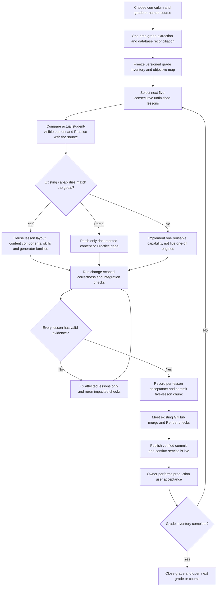

# Edulytics — Grade-First, Five-Lesson Curriculum Delivery Plan

**Plan ID:** `EDULYTICS-GRADE-FIRST-5-V1`  
**Status:** **Authoritative execution plan for future curriculum work** after T001  
**Adopted:** 2026-10-16  
**Repository:** `EIAS79/Edulytics`  
**Current initial programme:** `US-CCSS-MATH` (US Common Core Mathematics)  
**Release unit:** at most **five consecutive lessons from ONE grade or explicitly named high-school course**  
**Primary operating rule:** **Extract a grade once; prepare and test five lessons at a time; reuse existing teaching/Practice/Math infrastructure; commit; publish with appropriate change-scoped checks; owner tests on production.**

> This is a **plan and operating specification**, not a claim that a new automated five-lesson pipeline or CI workflow has already been implemented. Existing GitHub branch protections, CI requirements, Render deployment triggers, security controls, and audit records stay in force until explicitly changed and tested.
>
> **الملخص:** نعمل صفًا بعد صف. نستخرج فهرس الصف ومصادره مرة واحدة، ثم نكمل خمس دروس متتالية، نعيد استخدام المحتوى والمحركات والواجهات، نختبر فقط ما تغير، نرفع دفعة صغيرة، ونكرر حتى ينتهي الصف؛ بعد النشر يجرب المالك الدروس بنفسه.

---

## 1. Decision, priority, and supersession

1. The **grade/course** is the unit of curriculum planning and completion. Work starts with Grade 1, moves to Grade 2, etc., within the selected curriculum; high-school *named courses* follow their actual curriculum structure instead of invented grade labels. Do **not** mix courses, curricula, or grades in a five-lesson batch.
2. The **delivery chunk** is five consecutive canonical `LessonCode` records in the grade's stable source order. Final chunks of one to four lessons are valid; **do not pad or pull in lessons from the next grade**.
3. Extract each grade's source index and reconcile its database records **once**, then cache/version the extraction for reuse. Re-extract only when the source, edition, curriculum inventory, or relevant records actually change.
4. Existing content and UI are the **default starting point**. First inspect and reuse. Change teaching content only to repair a documented mismatch; create a new mathematical generator or interactive component only when no correct reusable capability covers the objective.
5. Test **changed behavior**, not the whole platform automatically for each chunk. Required repository-wide CI/branch protection still applies until a separately verified workflow change is shipped. Never bypass red checks or re-label missing evidence as a pass.
6. Existing **T001 Grade 1 Lessons 01–10** are preserved as two completed five-lesson chunks (`G1-001` and `G1-002`), not deleted, re-created, or re-certified by assertion. The next target is **G1 Lessons 11–15** (`G1-003`), subject to the grade inventory checkpoint.
7. Five-lesson chunks may be committed and shipped incrementally; **a whole grade need not wait for one gigantic final release**. Finish Grade 1 before starting Grade 2 as the normal sequence.

### Which previous instructions this replaces

| Historical document / rule | Status under this plan |
|---|---|
| `docs/curriculum/US_CCSS_GRADE_BY_GRADE_LESSON_ACADEMIC_CERTIFICATION_PLAN.md`, formerly compulsory `500 + 500 + 500 + 60` | **Superseded for future scheduling, gate scope, and release granularity.** The former document location now points here. Historical content is available through Git history; do not run 500-lesson blocks as the new default. |
| T001 first-ten manifest and `docs/curriculum/T001_AUTOMATED_LESSON_ACCEPTANCE.md` | **Historical T001-specific policy/evidence** for the ten already implemented and shipped. Do not silently apply its fixed ten-lesson SHA/check names to new five-lesson chunks. |
| `artifacts/academic-us-ccss/04-lesson-certification-records.json` and existing six-gate records | Preserve historical evidence and statuses. Do not mass-edit, delete, manufacture PASS evidence, or translate its older decision names into new approvals without migration. |
| Uploaded ~1,500-lesson curriculum roadmap / integrated math master plan (not present under those filenames on `main` at plan creation) | Not authoritative for the **new batch ordering/timing**. Reuse valid Track A/Track B architecture and mathematical correctness requirements; do not erase useful engine specifications. |
| Source registries, standards maps, security tests, mathematics engine architecture, licences, existing school adoption rules | **Retained**; execution-schedule changes do not waive correctness, privacy, licensing, or production safety. |

**Rule of precedence:** For future curriculum batch operations use **this document**; for an already published T001 build use its actual commit, archived audit trail, and source-specific historical checks; for security/deployment obey current executable protections until intentionally updated.

---

## 2. Programme and grade order

**Initial programme:** US Common Core Mathematics (`US-CCSS-MATH`). The currently documented inventory covers **1,560 unique lessons**, Grades 1–8 plus explicitly named high-school courses and supplements; **Kindergarten is not in that recorded scope**. This inventory is **not** a count of approved lessons.

| Order | Grade/course in existing inventory | Recorded lesson count | Planned chunks of up to 5 |
|---:|---|---:|---:|
| 1 | Grade 1 | 146 | 30 |
| 2 | Grade 2 | 146 | 30 |
| 3 | Grade 3 | 143 | 29 |
| 4 | Grade 4 | 149 | 30 |
| 5 | Grade 5 | 148 | 30 |
| 6 | Grade 6 | 147 | 30 |
| 7 | Grade 7 | 145 | 29 |
| 8 | Grade 8 | 131 | 27 |
| Then | Algebra 1 | 132 | 27 |
| Then | Geometry | 124 | 25 |
| Then | Algebra 2 | 120 | 24 |
| Then | Named advanced supplements/courses | 29 in total across several separate courses | Separate short chunks **inside each named course** |

**Counts are a snapshot**, taken from `docs/curriculum/us-ccss-g1-g12-structural-audit.json` (snapshot dated 2026-10-11). Reconcile with the current database and official source before freezing each grade manifest; do not blindly assume a grade/course is complete or academically approved because its index exists. Total chunk counts for separate high-school supplements must be calculated **per named course**, not by pooling unrelated lessons.

**Grade 1 baseline:** 146 inventoried; 10 from T001 already internally approved and deployed; 136 remain to process (**27 full chunks + one final single-lesson chunk**). Grade 1 therefore has 30 chunks overall; the next is lessons **11–15**. Cross-unit chunks within the *same grade* are allowed if required by the stable grade order; preserve each lesson's original unit and source identifiers.

**Later programmes:** The British/England, UAE, and Polish curriculum packs already represented in Edulytics are **not automatically included** in this US-CCSS execution count. Apply the same grade-first mechanism separately when explicitly selected, respecting each curriculum's own grade/year/stage naming and edition, rather than mapping foreign levels to US Grade 1 by guesswork.

---

## 3. Execution map



### Two independent technical tracks

- **Track A — Curriculum/lesson intelligence:** which publisher objective, standards outcome, grade, prerequisite, worked examples, representations, teaching content and **allowed/forbidden Practice families** belong to this exact lesson?
- **Track B — Mathematics intelligence:** can our existing generator, solver, verifier, normalizer, feedback and adaptive question selector support that skill safely?
- The **SkillContract** binds A to B. The lesson's student-visible body and the real Practice behaviour are both checked against this contract, so changing prose cannot silently leave unrelated questions attached to it.
- Reuse the existing Rich Lesson Content / Rich V2 composer, Practice V1 and Adaptive V2, first-party visual components, and database-backed scoring. **No custom Razor/React or JavaScript UI rebuild for a normal text/content-only lesson.**

---

## 4. One-time grade intake (not repeated for every 5 lessons)

**Input:** curriculum ID, actual grade/course label, edition/version, official publisher preparation/lesson sources already authorized, standards mapping, canonical Edulytics content, and actual database inventories. For US Grade 1 T001, the documented original preparation pages use **Illustrative Mathematics / Kendall Hunt IM K–5 2021**, aligned to US CCSS. Verify the source edition for each subsequent grade; do not assume every grade or foreign programme uses this edition.

**Procedure:**

1. Enumerate all canonical `LessonCode` records ordered by official grade/course, unit and lesson sequence; check missing IDs, duplicates, optional lessons and discrepancies between database, content bundles and publisher index.
2. Capture each lesson's title, exact source URL, source edition, content hash (when available), CCSS/official outcomes, objectives, representations/activities, and licence/attribution flags. Keep publisher HTML and third-party images out of Git unless the licence and authorization allow them.
3. Read the **existing actual learner-visible material**, after canonical JSON materialization / runtime patches—not merely template file titles. Locate explanation, goals, examples, common mistakes, images, summary, Practice contracts, generator families and feedback.
4. Match objectives to existing canonical skills and shared capabilities; create a **gap inventory**. Classify each lesson `READY_REUSE`, `CONTENT_REPAIR`, `PRACTICE_REPAIR`, `NEW_SHARED_CAPABILITY`, or `BLOCKED_SOURCE`.
5. Freeze a grade-specific, reproducible manifest containing ordered lesson IDs, source/edition identity, relevant content/version hashes, change classification, known prerequisites, current approval and production states, and last-verified date. **This is the grade's reusable input.**
6. Produce batch slices of five. Track current grade and next unprocessed ordinal in a checkpoint; do not redo source intake each session.

**Re-intake trigger:** source edition changed, grade inventory changed, hashes changed, mapping drift detected, or authorization/licensing changed. If only one lesson changed, update its record; don't repeat all source reading unless necessary.

**Proposed repository conventions** (directory names are **targets**, not assertions that those tools/files already exist):

```text
docs/curriculum/
  EDULYTICS_GRADE_FIRST_FIVE_LESSON_EXECUTION_PLAN_V1.md  # policy
artifacts/curriculum-delivery/
  US-CCSS-MATH/
    G1/
      grade-manifest.json             # stable grade inventory + source hashes
      progress.json                   # next chunk and reviewable state
      batches/
        G1-001.json                   # 01–05, T001 historical
        G1-002.json                   # 06–10, T001 historical
        G1-003.json                   # 11–15, next planned chunk
```

Keep detailed logs, screenshots, generated student responses and browser traces as **CI artifacts** or private temporary evidence rather than placing unnecessary student/publisher data in the repository.

---

## 5. The five-lesson production cycle

### Stage A — Select and compare (all five together)

- Load the **next five** lesson records by stable grade ordinal and original source unit association; never choose random lessons or skip a blocked one without documenting the reason.
- Compare each lesson's actual learning outcomes against the effective teaching body and the current Practice contract, examples, explanations and expected student response.
- Group defects by type; one shared issue (e.g., wrong graph-family mapping) is fixed once for all affected lessons.
- Do not rewrite content that already teaches the correct objective, even if another stylistic version could be generated.

### Stage B — Prepare accurate teaching content

- **Reuse first:** existing explanation, worked examples, step-by-step methods, diagrams, misconception corrections, summary, age-appropriate language and the Rich V2 layout.
- **Modify only when needed:** incorrect mathematics, omitted learning objective, confusing age level, unsupported representation, mismatch between explanation and exercised skill, faulty worked step, missing accessibility description, licence/attribution issue.
- Use **structured lesson data** (goal, introduction/activity, concepts, examples, worked steps, answer checks, mistakes/corrections, summary, learning-task metadata) in the shared renderer. No per-lesson UI coding for text changes.
- If original material must be paraphrased or first-party authored, preserve the **instructional goal** rather than blindly copying publisher prose, artwork or trademarks.
- The teacher's narrative goal and what a self-paced digital activity can automatically prove are different: retain real-world tasks pedagogically, but don't claim a synthetic test performed a real classroom survey.

### Stage C — Connect precise Practice

- Assign the existing canonical `SkillContract`, approved family/families, difficulty range, parameter/domain bounds, answer representation and verifier, including prohibited unrelated fallback families.
- Verify that questions measure the **same work the learner was taught**, not merely the same broad topic. If the lesson asks a child to **construct** an expression, sort a set of objects, or build a graph, do not silently replace the target with a generic multiple-choice question.
- Prefer **existing math capability**. Only extend Track B when an important skill cannot be represented, generated or graded correctly; implement the capability generically where possible so later lessons share it.
- Verify independently that generated correct answers match the lesson, and a plausible wrong response is rejected. Confirm parameter variation does not exceed grade and skill constraints.
- Preserve student ownership, actual server grading and persisted attempts. Do not alter student grades, school adoptions, tenant membership, historic assessments or official outcomes as a side effect of lesson authoring.

### Stage D — Verify the change, not the entire programme

Minimum *targeted* acceptance for each modified lesson:

1. **Identity and source:** title, grade, `LessonCode`, unit, outcome mapping, edition/provenance, licence flag and absence of unrelated content.
2. **Visible content:** the actual composed student lesson contains the goal, appropriately correct steps/examples/representations and a valid summary; required assets resolve.
3. **Practice fidelity:** the lesson chooses only allowed families; generation produces diverse valid items; an independent verifier accepts correct answers and rejects wrong/malformed ones.
4. **Integration only as affected:** confirm the changed component is reachable via the real Practice path and student work/grades persist. A newly authored interaction gets targeted desktop/mobile, keyboard, submission and accessibility checks.
5. **Safety:** a change to authentication/ownership/school isolation must receive scoped negative authorization tests; otherwise do not rerun every tenant test for text-only changes.
6. **No counterfeit success:** missing source/licensing evidence, a failing scoped test, or an unimplemented capability leaves the affected lesson `BLOCKED`/`FAILED` and unapproved.

**Verification selection matrix**

| Change type | Targeted checks on every affected lesson | Larger checks? |
|---|---|---|
| Correct text/example/summary or metadata only | Content schema/render checks; reference math for changed examples; source/goal match | No full-project regression solely for a text edit |
| Existing skill/Practice family re-mapped | Contract/family selection, parameter boundaries, independent grading, reject wrong answers, persistence path if mapping changed | No global sweep by default |
| New generator, solver or answer format | Dedicated mathematical property/edge/negative tests and integration; ensure shared-family consumers are not broken | Add impacted shared-engine consumer tests |
| New/altered interactive UI | Component tests; focus/keyboard and responsive rendering; targeted Chromium flow and saved-score test | No all-lessons browser crawl |
| Shared core engine, auth, grading persistence, schema/migration, multi-tenant boundary | Integration plus relevant broad regression/security/migration tests | **Yes**: risk-based wider CI, not optional bypass |
| Deployment configuration or release pipeline changed | Validate workflow/branch protection, deploy trigger, readiness, rollback path | **Yes**: deployment checks before changing production rules |

**Important current-state constraint:** Existing GitHub workflows, required status checks and Render's `checksPass` deploy trigger **already exist**. This plan does **not** disable them today. Simplifying CI requires an explicit follow-on engineering change to path-sensitive checks, branch protection, build dependencies and deploy gating, plus validation that documentation-only commits do not break production delivery. Until then, the present mandatory checks run normally.

### Stage E — Finish the chunk

- A **chunk has five independently evidenced lesson records**, including `sourceVersion/contentVersion`, mapped skills, changed files, tests and resulting Git SHA. The last partial chunk uses its actual count.
- One failed lesson is **not silently counted as approved**; fix that lesson and rerun its impacted checks. Other lesson records can be retained as ready, but the owner must not be told that a five-lesson chunk is complete when one isn't.
- For the new workflow, the internal Edulytics decision is **per-lesson test-based acceptance, aggregated in a five-lesson delivery report** (e.g., `5/5 accepted`); no mandatory external academic specialist signature. No blanket approval based on code compiling alone.
- Proposed new status: `LESSON_INTERNAL_ACADEMIC_ACCEPTED` backed by source/content/Practice evidence; aggregate `CHUNK_5_READY` only when every included lesson passes. **These new status identifiers are specified here but are not yet implemented in the current legacy T001 gate.** Implement a lightweight scoped evaluator instead of faking the old ten-lesson or 500-lesson gate.
- Commit one coherent chunk (or a small number of focused commits) and open/merge a PR under current GitHub protections. Record accurate SHA, affected lesson IDs, minimal test evidence and any actual remaining limitations. No mandatory 10–25 minute manual certification-report ritual.

### Stage F — Deploy and owner acceptance

- Publishing is **one small chunk at a time**, subject to normal protected GitHub `main` merge rules and Render `checksPass` policy. A Git commit or green build is not proof that production is live.
- Verify deployment ID, exact commit SHA, `live` state, basic HTTP health, and grade/lesson inventory. If deployment fails, do not announce it as published; preserve previous live release, diagnose, and retry only after evidence warrants it.
- The product owner prefers to test functionality **personally in production after each commit/deployment**. Provide direct lesson URLs or the authenticated navigation path and a short manual UAT checklist: read content, generate Practice, deliberately submit right/wrong responses, inspect grade/saved attempt, view on phone when the UI changed.
- Report owner-found bugs as a scoped fix; redo only affected validation unless the fix touches shared functionality.
- If a schema/data migration is involved, follow the production backup and migration runbooks. Do not create a fresh database branch for every text-only batch; avoid unnecessary production data mutations.

---

## 6. Suggested data contracts (for future implementation)

The following is an illustrative shape, **not** a claim that these fields are already in the production data model:

```json
{
  "planId": "EDULYTICS-GRADE-FIRST-5-V1",
  "curriculumId": "US-CCSS-MATH",
  "gradeOrCourse": "Grade 1",
  "edition": "IM-K5-2021",
  "gradeInventoryVersion": "<verified source/DB snapshot hash>",
  "batchId": "US-CCSS-G1-003",
  "ordinals": [11, 12, 13, 14, 15],
  "lessonCodes": ["<five verified canonical LessonCodes>"],
  "classification": "<per-lesson READY_REUSE or repair category>",
  "status": "PLANNED",
  "targetCommitSha": null,
  "acceptance": {
    "approvedCount": 0,
    "blockedCount": 0,
    "policyVersion": "EDULYTICS-GRADE-FIRST-5-V1",
    "tests": [],
    "evidenceReferences": []
  },
  "deployment": {
    "renderService": "Edulytics",
    "renderDeployId": null,
    "liveCommitSha": null,
    "ownerUat": "NOT_STARTED"
  }
}
```

Never commit tokens, database passwords, identifying student responses, unlicensed publisher assets, or invented PASS timestamps. Use proper schema and typed records when building the real tool; JSON above defines intended semantics only.

### Lesson and chunk states

```text
GRADE_INVENTORIED
    -> CHUNK_PLANNED -> LESSON_REUSE_READY / LESSON_REPAIR_REQUIRED / LESSON_CAPABILITY_REQUIRED
    -> LESSON_TESTED / LESSON_BLOCKED
    -> LESSON_INTERNAL_ACADEMIC_ACCEPTED (for each genuinely passing lesson)
    -> CHUNK_READY (all 5, or all remaining 1–4)
    -> COMMITTED -> MERGED -> DEPLOYING -> LIVE -> OWNER_UAT
    -> GRADE_COMPLETE (only after inventory exhaustively reconciled)
```

When a lesson is blocked, capture `LessonCode`, missing evidence or failing test, severity, owner/fix, and stable checkpoint. Resume the same grade; don't skip the lesson and imply the grade is complete.

---

## 7. Efficiency model and realistic timing

**Targets, not a historical measured throughput or guarantee.** Fast AI text extraction is not 30 minutes of human reading. Scale comes from one-time indexing, deterministic comparisons, reusable components and running small tests concurrently.

| Work item | Engineering approach | Initial target if all dependencies already exist |
|---|---|---|
| Grade intake | One extraction + database/source reconciliation for the entire grade | Measure empirically per grade; **not billed again per 5 lessons** |
| Single `READY_REUSE` lesson | Match source, preserve/adjust text and map existing family | **5–15 minutes** preparation and focused verification |
| Normal five-lesson chunk | Work on five from cached manifest; share code/layout/templates | **~25–75 minutes** of preparation for five standard lessons (planning target, not observed) |
| Targeted checks for the chunk | Group and parallelize unit/content/family checks | **~1–5 minutes** for the checks themselves where runners are warm (target; may vary) |
| New complex skill, solver, UI, source/licence gap or flaky environment | Separate reusable engineering task | **Variable; not capped by the fast-path target** |
| Merge-to-production | Current CI + queue + Render build/cold start | **Variable; track separately from lesson authoring**, never promise a fixed SLA |

**Measure rather than guess:** capture automated wall-clock durations per stage, *productive engineering edits* vs CI waiting, reused vs newly authored capability, test reruns, bugs escaped to owner UAT, % auto-aligned, and throughput per grade. Adjust targets after the next **three five-lesson chunks**. Parallel CI durations are not summed as though they were sequential developer work.

---

## 8. Non-negotiable correctness and change boundaries

- Do not fabricate academic accreditation by government, CCSS, IM/Kendall Hunt, schools or an external specialist. `INTERNAL` means Edulytics' own test-defined acceptance.
- Do not represent synthetic survey votes or test fixtures as proof that actual pupils learned or that human participants responded.
- Do not treat successful compilation as proof of aligned teaching content or correct grading.
- Do not skip unresolved source/licensing issues. Preserve existing publisher attribution and first-party asset constraints.
- Do not change curriculum IDs, official outcomes, school-adoption mappings, student grades, teacher assessments or other grades unless the change itself is explicitly scoped and verified.
- Do not force-delete old evidence, flatten ten-lesson historical SHA ledgers into invented five-lesson PASS records, or retroactively rewrite already-shipped results.
- Do not modify required CI, branch-protection rules, deployment triggers, Neon state or Render services as a side effect of merely adopting this markdown plan.
- No false background-work promises. An agent can resume from a saved checkpoint when invoked, or use an explicitly configured automation; ordinary chat alone is not a persistent job runner.

---

## 9. Implementation roadmap for this new process

| Phase | Deliverable | Exit criterion |
|---|---|---|
| **P0 — Authoritative policy** | This document in `docs/curriculum/`; retire the old mandatory 500-batch instructions as active policy | New plan linked; historical T001 and evidence preserved |
| **P1 — Grade extractor** | CLI/service reading existing official source index and current DB, building versioned grade manifest and source/content fingerprints | Deterministic grade counts, zero duplicates and missing code reporting |
| **P2 — Reuse/gap classifier** | Per-lesson alignment and capability resolver; unified defect ledger with `READY_REUSE` / specific blockers | All five candidates classified before edits |
| **P3 — Five-lesson scoped validator** | Cheap checks selected by actual touched files, skill families and shared dependencies; per-lesson evidence with exact Git SHA | Fail-closed on missing/wrong answers and bad source alignment; no false PASS |
| **P4 — GitHub / Render CI optimization** | Analyze required checks and protect critical gates while skipping unaffected global expensive suites for routine lesson-only PRs | Existing security protections retained; validated checksPass-compatible deployment |
| **P5 — Production rhythm** | First new Grade 1 chunk L11–L15, then L16–L20, etc.; owner production UAT/checkpoint after each batch | Each chunk carries real accepted lessons and confirmed live commit |
| **P6 — Grade closure** | Grade manifest all lessons accounted for (including optional/source-blocked status), link each published chunk and record final grade status | `146/146` statuses reconciled for Grade 1; no silent skips |
| **P7 — Repeat** | Grade 2 then Grade 3 etc., later named high-school courses | No duplicate intake/engine reimplementation without justification |

**Rollout order:** P0 documentation now. P1–P4 require actual engineering implementation and measured validation before declaring the optimized pipeline operational. P5 must use the current safe workflows until P4 is real. Grade 1 T001 first ten remain delivered under their prior verified policy.

---

## 10. Owner-facing report after each chunk

Keep the update compact. Example format:

```text
Curriculum / grade: US-CCSS Mathematics / Grade 1
Batch: US-CCSS-G1-003  |  source ordinals: 11–15
Previously live: L01–L10
Prepared: 5/5 | internally accepted with evidence: <actual>/5
Reused: <number> | content repairs: <number> | new shared components: <number>
Targeted checks: <actual pass/fail with links>
Commit/PR: <actual SHA/URL> | production deploy: <actual Render ID/status>
Owner UAT: PENDING / PASS / ISSUES_FOUND
Blockers: <specific LessonCode and reason, or NONE>
Next: US-CCSS-G1-004 (L16–L20), only when this batch is accounted for
```

Do not fill any field with guessed values or present `READY_REUSE`, code compile success, merge success, internal academic approval, and production `LIVE` as interchangeable events.

---

## 11. Acceptance criteria for this PLAN document

This document is active when committed on `main` and its supersession link is in place. That **does not mean** the new grade extractor, lightweight validator, or CI optimization is deployed. The next execution task is to build those supporting tools **without changing the ten lessons already live**, inspect the Grade 1 inventory, and start `US-CCSS-G1-003` (L11–L15).

**Governing principle:** *Grade-first curriculum truth; five-lesson delivery increments; reuse by default; targeted tests by change impact; genuine evidence for internal acceptance; release only under working GitHub/Render protections; owner validates production experience.*