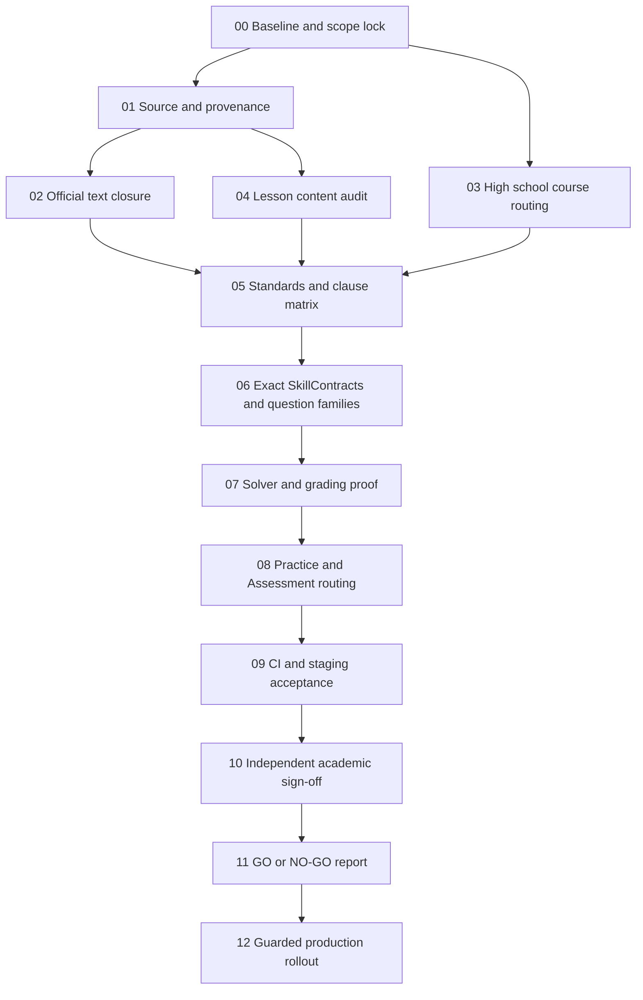

# Edulytics — US Common Core Mathematics
## خطة التنفيذ والإثبات للوصول إلى الاعتماد الأكاديمي الداخلي الكامل

**Document ID:** `EDU-US-CCSS-ACADEMIC-CERTIFICATION-2026-10-11`  
**Version:** `1.1 — unified lesson-by-lesson certification execution`  
**Prepared:** `2026-10-11`  
**Updated / execution started:** `2026-10-12` (Europe/Warsaw)  
**V1.0 preservation:** الخطة الأصلية محفوظة كمرجع تاريخي؛ هذه النسخة تضيف انضباط التنفيذ والتغطية لكل درس دون إنشاء برنامج موازٍ.  
**Repository:** [`EIAS79/Edulytics`](https://github.com/EIAS79/Edulytics)  
**Curriculum:** `US-CCSS-MATH` / `CCSSM-2010`  
**Scope:** Mathematics, Grades **1–8** and high-school pathways/courses serving **Grades 9–12**. **Kindergarten is excluded** from this certification scope.  
**Current academic release decision:** **`NO-GO`**.  
**Document owner:** Edulytics Curriculum / Academic Quality + Engineering; independent academic reviewer sign-off required.

> **نطاق عبارة «معتمد أكاديميًا»:** المقصود هنا **اعتماد داخلي قائم على أدلة قابلة للتدقيق** بأن محتوى Edulytics ومهاراته وأسئلته وتقييمه يغطي نطاق Common Core الأمريكي المحدد. **هذا لا يساوي ولا يدّعي شهادة اعتماد من وزارة أو جهة تنظيمية أو ناشر أو منظمة Common Core.** أي اعتماد رسمي خارجي يتطلب عملية وقرارًا منفصلين صادرين عن الجهة المخولة.

---

# 0. اتفاق التنفيذ الموحد — تحديث V1.1 (يُقرأ قبل جميع المراحل)

> **قرار إدارة المشروع:** نستمر في **الخطة الحالية نفسها Phases 00–12**؛ ليست هناك «خطة ثانية» للـ1,560 درسًا. يتم إنجاز الجزء المشترك مرة واحدة وإنتاج دليل قابل لإعادة الاستخدام في Phase 04/05/06/07/08/10. اختبار GitHub CI ليس اعتماد درس، والتوقيع البشري ليس فحصًا آليًا.

## 0.1 النطاق والموعد

- **تاريخ بدء التنفيذ الفعلي:** **2026-10-12**، بدءًا بـPhase 00 (قراءة فقط). هذا تاريخ بدء، **وليس موعدًا متخيلًا لإنهاء الاعتماد**.
- **النطاق الثابت:** `US-CCSS-MATH`, `CCSSM-2010`, **1,560 درسًا** في الصفوف G1–G8 ومقررات الثانوية التي تخدم G9–G12؛ Kindergarten خارج النطاق. رقم 1,560 خط أساس هيكلي أعاد تقرير المشروع الحالي عرضه، ويعاد توليده عند قفل مرشح الإصدار.
- **سجل العمل:** GitHub `EIAS79/Edulytics`، نفس PR/branch الجاري إذا كان نظيفًا وسليمًا؛ لا يُنشأ repo أو branch موازٍ لمجرد تعديل خطة.
- **الحالة الأكاديمية:** `NO-GO` حتى اكتمال جميع الأدلة والتوقيعات. **ليس اعتمادًا خارجيًا**.
- **تاريخ الانتهاء:** يتحدد **باجتياز Gate 12** وبقاء كل 1,560 درسًا وكل معيار ومهارة ضمن نسخة مصادق عليها؛ لا نضع ETA غير مسنود بقدرة المراجعين وسعة بيئة الاختبار. نشر المرشح الفني يمكن التحضير له قبل التوقيع، لكن لا يُعلن `CERTIFIED_FULL` قبله.

## 0.2 نقطة الانطلاق المثبتة في GitHub بتاريخ 2026-10-12

| عنصر | نتيجة فحص GitHub مباشرة | معنى النتيجة |
|---|---|---|
| `main` | `fd72849823ae31b92e58fb420a373218fc25b328` | baseline مستقر للمقارنة، **وليس** SHA شهادة نهائية |
| [PR #464](https://github.com/EIAS79/Edulytics/pull/464) | `OPEN / DRAFT`، HEAD `1c001a78948b664bf98b232a21bf903c5713eb60` | يحتوي إصلاحات هندسية/أدلة؛ **غير مدمج** |
| GitHub CI على HEAD أعلاه | **9/9 workflows = SUCCESS** وقت التحقق | نجاح software gates على **هذا الـSHA فقط**، وليس صحة 1,560 درسًا |
| [PR #461](https://github.com/EIAS79/Edulytics/pull/461) | **MERGED / CLOSED** | تحديث حالة تاريخية في V1.0؛ لا تعاد المهمة باعتبار PR مفتوحًا |
| [Issue #453](https://github.com/EIAS79/Edulytics/issues/453) | **OPEN** | إغلاق مقررات HS/legacy/staging لم يثبت بمجرد دمج PR #461 |
| الجرد المرفوع في GitHub | ملف `docs/curriculum/us-ccss-g1-g12-structural-audit.json` مع `sourceCommit=fd728498` يعرض **1,560 درسًا / 363 معيارًا أم** | **جرد بنيوي** مُعاد العثور عليه، ولا يساوي مراجعة أو توقيعًا |
| الأدلة السابقة | `artifacts/academic-us-ccss/EXECUTION_STATUS.md` و`00-baseline.json` موجودان | توجد خطوات سابقة جزئية يجب التحقق منها بدل نسخ حالات PASS |
| البيئة الحية / الحقوق / مراجعة بشرية | **لم تتم إعادة فحصها في جلسة البدء هذه** | تبقى بواباتها مفتوحة؛ لا نستنتج حالة Neon أو Render الحالية |

**تمييز ضروري:** الصفحات التاريخية من V1.0 تسجل وقتها أن #461 كان مفتوحًا و`0/121` معتمدًا؛ لا تُمحو هذه الوقائع بأثر رجعي. الملحق الحالي أحدث فيما يخص **حالة GitHub فقط**. جميع أرقام تغطية المعايير والنصوص المخالفة والاعتماد هي أهداف/نتائج تاريخية حتى يعاد توليد أدلتها على SHA المرشح.

## 0.3 دفتر سير العمل — المسؤولية والتسلسل

تُطبَّق **بوابات قبول** لا تواريخ إنهاء مصطنعة. لا تُرفع مرحلة إلى `PASS` لمجرد وجود ملف JSON أو نجاح CI.

| المرحلة | حالة البداية في 2026-10-12 | أول عمل محدد | شرط انتقال المرحلة |
|---|---|---|---|
| 00 — Baseline | **STARTED / PARTIAL** | SHA + حالة PR + CI تحققوا؛ تبقى source/live/staging matrix وجرد مُعاد | كل أرقام الـscope ومصادرها وبيئاتها متوافقة على baseline موثق |
| 01 — Source/Licensing | **PARTIAL، لا اعتماد** | تدقيق `01-*` وسلسلة ترخيص/نَسب كل مادة | 100% source/provenance، 0 `BLOCKED_SOURCE` غير محسوم |
| 02 — Official Text | **BLOCKED تاريخيًا** | تحديث disposition للـ98 التاريخية والتحقق من HS وتصحيحات Neon read-only | 0 خلافات غير محسومة، وتطبيق مصرح به وتحقق SHA/digests عند الحاجة |
| 03 — HS Courses | **BLOCKED** | إعادة تقييم #453 بعد دمج #461، ومراجعة adoptions القديمة | CourseCode واضح وno leak ومسار مدرسة–طالب–معلم مثبت |
| 04 — Lesson Content | **PARTIAL (automated audit فقط)** | سجل اعتماد/تدقيق منفصل لكل درس، ثم دفعات فعلية | **1,560/1,560** مراجعة محتوى موثقة ومشكلات المحتوى مغلقة؛ التوقيع النهائي Phase 10 |
| 05 — Standards/Clauses | **BLOCKED** | إغلاق traceability للـ363/121 مقابل المحتوى والأسئلة | كل متطلب لديه دليل مكتمل `READY_FOR_SIGNOFF` بلا فجوة أو ربط ملفق |
| 06 — SkillContracts | **PARTIAL/BLOCKED** | قفل المهارة وعائلة الأسئلة والـnegative routes لكل درس | 0 `unserved_competencies`/`wrong_topic_route` في نطاق الإصدار |
| 07 — Solver/Grading | **PARTIAL/BLOCKED** | براهين صحة مستقلة وrubrics للتعبير والرسوم والبراهين | كل شكل إجابة مطلوب له مصحح/rubric مثبت وصحيح ضمن corpus |
| 08 — Product Flows | **BLOCKED** | Practice/Assessment/Adaptive/Mastery والحدود بين المدارس والمقررات | جميع المسارات المؤثرة صحيحة وحافظة للبيانات |
| 09 — CI/Staging | **PARTIAL** | CI على final SHA، disposable DB وStaging حقيقي بتصريح | full regression + HTTPS real flows + DB migration checks = PASS |
| 10 — Human Academic Signoff | **NOT VERIFIED** | إسناد مراجعين لكل صف/مقرر، قرارات لكل درس وبند معيار | 1,560 قرار درس + 363/121 مراجعة وتوقيع مستقل، 0 اعتراضات |
| 11 — Certification Decision | **NO-GO** | تجميع ledger وتوقيعات وأثر CI/بيئة + قرار الإصدار | القرار يُشتق آليًا ويراجَع بشريًا على نفس SHA |
| 12 — Production/Recertification | **NOT AUTHORIZED** | backup/rollback وdeploy مشروط ثم مقارنة digests وسلوك الطالب | الإصدار المعتمد نفسه منشور ومتحقق بعد النشر وتاريخ الشهادة محفوظ |

**اعتماديات التنفيذ:** لا غلق Phase 04 اعتمادًا نهائيًا قبل Phase 10، لكن لا نُعطل جمع ومراجعة *أدلة المحتوى* بانتظار توقيع المرحلة 10. يمكن تنفيذ 02/03/04 بالتوازي بعد تثبيت 00/01، ثم ربط 05→08، ثم 09→10→11→12. لا تَناقُض دائري بين Gate 04/Gate 05 وبين التوقيع في Phase 10: القبول المبكر = evidence `READY_FOR_SIGNOFF`؛ النهائي = `ACADEMICALLY_CERTIFIED` بعد المراجع.

## 0.4 سياسة متابعة التنفيذ والتقارير

1. **قياس التقدم الأساسي**: `reviewed_lessons/1560` و`certified_lessons/1560` و`resolved_defects` و`parent/child_coverage` و`human_signoffs`، لكل صف/مقرر. لا نقيس إنجاز المنهج بعدد commits أو بعداد CI فقط.
2. **تُراجع جميع الدروس**: دفعات إدارية مبدئية تصل إلى **40 درسًا** = **39 دفعة** عند ثبات 1,560 درسًا. حجم الدفعة قابل للتعديل إذا تطلبت المراجعة تقسيمًا أصغر؛ لا يعني إكمال 39 دفعة تلقائيًا الحصول على التوقيع.
3. **دفعة أولى Pilot** تشمل حالات معتمدة على المصدر عبر `Compute`, `Explain`, `Represent`, `Graph`, `Construct`, `Prove` بحسب الصف والمرحلة، للتحقق من نموذج الأدلة والاختبارات. بقية الدفعات مجمعة بالصف/المقرر/المهارة لتقليل تكرار المراجعات.
4. لا توضع حالة `PASS` للدرس إذا كان فحصه آليًا فقط. AI يستخرج ويراجع ويقترح ويؤلف تصحيحات أصلية؛ **بشر مؤهلون يقررون الاعتماد**.
5. شغّل أدوات التدقيق واختبارات الدروس/العائلات **محليًا أو في CI المستهدف** قبل commit واسع. اجمع الإصلاحات المرتبطة في commit منطقي، ثم شغّل **workflows GitHub التسعة** أو قائمة CI الإلزامية *مرة لكل commit تغييري منطقي/مرشح إصدار*، **ليس مرة لكل درس**. تجنب commits للتقارير الشكلية إذا ستعيد تشغيل كل build دون ضرورة؛ الاستفادة من run واحد لنفس SHA هي الأصل.
6. **لا رسائل تقدم عند 2/9 أو 3/9**: إذا بدأت فحوص CI لدفعة، توثق نتيجة نهائية `PASS/FAIL` مع السبب ورابط run/sha، ولا تطلب «كمل» لمجرد أن CI لم يكمل؛ حالة `RUNNING` تذكر فقط إذا كان لا بد من إغلاق التفاعل قبل اكتماله، ولا تدّعي النجاح.
7. أي `FAIL` يمنع دمج الدفعة؛ أصلح السبب الحقيقي وراجع الاختبارات المتغيرة بوعي، ولا تُعدّل الاختبار كي يمر على نحو يخفي انحدارًا وظيفيًا.
8. لا commit إلى `main` ولا deploy إلى Render/Neon ولا تعديل سجلات طالب حقيقية دون بوابات الموافقة والأدلة اللازمة. بيانات الدخول تعامل بصورة آمنة، ولا تنسخ كلمات مرور إلى المحادثة أو artifacts.
9. **تقرير الدفعة الوحيد**: بدأنا من SHA كذا؛ دروس راجعناها/اعتمدناها؛ أخطاء مثبتة وأدلة/إصلاحات؛ الاختبارات النهائية المرتبطة بالـSHA؛ عوائق مفتوحة؛ القرار/الخطوة التالية. لا خلط بين `audited`, `repaired`, `reviewed`, `certified`.

## 0.5 تعريف إنجاز الدرس الواحد — سبع بوابات إلزامية

| بوابة | الأدلة الدنيا لكل `LessonCode` | جهة التحقق |
|---|---|---|
| L1 — Standards & Provenance | OfficialOutcome + source edition/URL/hash + حقوق الاستخدام + direct/parent-only/no alignment الموثق | source audit + curriculum reviewer |
| L2 — Mathematical Truth | التعريفات والرموز والصيغ والخطوات والمنطق صحيحة؛ الحالات الحدية والدقة والمجالات | اختبارات مستقلة + مراجع رياضي |
| L3 — Instructional Quality | الأهداف والمتطلبات السابقة والتدرج والمستوى والمفاهيم والأخطاء الشائعة تغطي المهارة فعلًا؛ لا filler عام | content review + evidence mapping |
| L4 — Examples & Representations | أمثلة محلولة بحلول مستقلة، وحدات ورسومات/خط أعداد/برهان عندما يلزم؛ تسلسل واضح | golden/properties/manual review |
| L5 — Practice & Assessment | SkillContract أصلي، family واقعية، levels مناسبة، حالات negative/wrong topic، grading/rubric عادلة | Track A→B acceptance evidence |
| L6 — Learner Delivery | النص الفعلي في Rich V2 والرموز والسياق والأسئلة المعروضة صحيحة؛ استقلال السياق والخصوصية | rendering/integration + authorized staging |
| L7 — Independent Human Sign-off | مراجع رياضيات مستقل يرى L1–L6 ويوقع قبول/رفض محددًا للدرس/المعيار/الإصدار | reviewer — **ليس CI أو AI** |

- حالات L1–L6: `NOT_STARTED | IN_PROGRESS | PASS | FAIL | BLOCKED`، مع `evidenceId` و`reviewedAtUtc` و`sourceSha`؛ **PASS** هنا تعني مرور فحص بعينه فقط.
- حالات الدرس: `QUEUED → AUTOMATED_SCREENED → CONTENT_REVIEWED → EVIDENCE_READY → AWAITING_ACADEMIC_SIGNOFF → ACADEMICALLY_CERTIFIED`، أو `BLOCKED/REWORK_REQUIRED`؛ لا تقفز إلى آخر حالة آليًا.
- عند تغيير source/explanation/skill/question family/solver/rubric/target SHA يعاد تقييم **المتأثر** تلقائيًا وتتوقف صلاحية توقيعه حتى إعادة الاعتماد على النسخة الجديدة.
- الدرس ذو قدرات `Construct` أو `Graph` أو `Prove` لا يجتاز L5 بمجرد سؤال اختيار متعدد؛ إذا تعذّر التصحيح الآلي، استخدم rubric ومراجعة معلم موثقة. لا يلزم اختراع family جديدة لكل درس؛ يمكن مشاركة families مثبتة بين دروس متعددة.

### شكل ملف الاعتماد الفردي المطلوب (مواصفة لا يُدعى تنفيذها حاليًا)

```json
{
  "lessonCode": "PED:US-CCSS-MATH:G2:U09:L12",
  "sourceSha": "<actual-baseline-sha>",
  "contentVersion": "<actual-version>",
  "gradeOrCourse": "Grade 2",
  "officialOutcomes": ["CCSS:2.OA.A.1"],
  "publisherEvidenceId": "<verified-source-ref>",
  "lessonSkillProfileId": "<actual-skill-contract>",
  "gates": {
    "L1": {"status": "NOT_STARTED", "evidenceIds": []},
    "L2": {"status": "NOT_STARTED", "evidenceIds": []},
    "L3": {"status": "NOT_STARTED", "evidenceIds": []},
    "L4": {"status": "NOT_STARTED", "evidenceIds": []},
    "L5": {"status": "NOT_STARTED", "evidenceIds": []},
    "L6": {"status": "NOT_STARTED", "evidenceIds": []},
    "L7": {"status": "NOT_STARTED", "evidenceIds": []}
  },
  "unresolvedDefects": [],
  "academicDecision": "NOT_CERTIFIED",
  "independentReviewerId": null,
  "signedAtUtc": null
}
```

**تعليمات التنفيذ:** لا تُعبأ `PASS` أو `reviewerId` أو `evidenceIds` افتراضيًا. يُنشأ `04-lesson-certification-records.json` بواقع **1,560 سجلًا فريدًا** من source inventory؛ يرفض validator التكرار أو النقص أو عدم تطابق الـSHA. يجري حفظ الدليل الكامل لكل درس، ولا يُحسب رقم `certified` إلا بعد L7.

## 0.6 الفارق بين إغلاق الخطة التقنية وإغلاق الاعتماد الكامل

- **Technical implementation complete**: الدروس والـAPIs والمحركات/قواعد التصحيح والاختبارات الأساسية يمكنها العمل، لكن حالة الاعتماد قد تظل `NO-GO`.
- **Internal academic certification complete**: جميع الدروس والـ363/121 مصدرًا ومهارة وتقييمًا قد اجتازت التحقق والتوقيع، ثم تحققت بيئة الإصدار؛ هذه وحدها تسمح بالعبارة المقيدة بـSHA والنطاق.
- **Production verified**: النسخة الموقعة والمنشورة متطابقتان، مع smoke checks وتاريخ re-certification. لا إعلان اكتمال Phase 12 قبل هذا الإثبات.

---

# 1. الهدف والقرار المطلوب

لا يُسمح بإظهار `ACADEMICALLY_CERTIFIED_FULL` أو إعلان «معتمد أكاديميًا بالكامل» إلا بعد إثبات جميع ما يأتي:

1. مطابقة رموز المعايير ونصوصها المعتمدة للمصادر الرسمية أو توثيق الفروقات المقبولة، بلا اختلاف غير محسوم.
2. وجود أثر تدقيقي صحيح: **المعيار / البند الفرعي → درس ناشر موثق → محتوى تعليمي → SkillContract → Question Family / Assessment Task → حل مستقل → قاعدة تصحيح → اختبار فعلي → موافقة مراجع أكاديمي**.
3. تغطية المتطلبات المعرفية الفعلية، وليس مجرد ظهور رمز المعيار في قاعدة البيانات أو نجاح السؤال حسابيًا.
4. صحة سلوك الطالب والمعلم والتقييم وحفظ المحاولات وعزل المدارس والمستخدمين في Staging، ثم التحقق بعد النشر.
5. الاحتفاظ بهوية الدروس، وروابط المعايير الرسمية، وتاريخ الأسئلة والتقييم والإتقان، وعدم إجراء ترحيل غامض لمدارس الإنتاج.

**معادلة القرار:**

```text
ACADEMICALLY_CERTIFIED_FULL =
    official_source_gate == PASS
 && parent_standard_gate == PASS
 && subordinate_clause_gate == PASS
 && lesson_content_gate == PASS
 && lesson_skill_contract_gate == PASS
 && assessment_and_grading_gate == PASS
 && high_school_course_routing_gate == PASS
 && acceptance_and_security_gate == PASS
 && academic_signoff_gate == PASS
 && release_evidence_gate == PASS
```

إذا فشل شرط واحد: **`NO-GO`** للنطاق الكامل. يمكن اعتماد **نطاق أصغر محدد بدقة** (صف/مقرر/مهارة) إذا اجتاز بواباته الخاصة، بشرط عدم تقديمه على أنه اعتماد جميع الصفوف.

---

# 2. خط الأساس المثبت وقت إعداد الخطة

> هذه **لقطة عمل** من تقارير المستودع والتدقيق السابق، وليست ادعاء بأن البيانات لن تتغير. أول خطوة تنفيذية هي إعادة توليد اللقطة من **SHA** محدد وعدم نسخ الأرقام دون تحقق.

| البند | الحالة المسجلة | ماذا يثبت؟ / ماذا لا يثبت؟ |
|---|---:|---|
| دروس Common Core في المخطط المقبول | **1,560** | جرد بنيوي؛ ليس شهادة جودة تعليمية لكل درس |
| معايير المحتوى الأساسية المرقمة | **363** | وجود رموز المعايير؛ لا يثبت إتقان جميع الفروع |
| روابط الدروس بالمعايير في فحص Neon | **2,882** | مطابقة هيكلية للمخطط المصدر؛ لا تثبت الدقة الدلالية للربط |
| بنود رسمية فرعية `a/b/c/...` | **121** | كلها تحتاج ملف إثبات مستقل |
| بنود فرعية لها مرجع ناشر برمز مباشر | **106** | دليل ارتباط بالناشر، وليس نجاح التقييم |
| بنود فرعية لها ربط بأصل المعيار فقط | **15** | تحتاج إثباتًا دقيقًا خاصًا بكل بند؛ لا تُختلق روابط |
| بنود فرعية لها *مسار تدريب مرشح* | **58** | مرشحة للمراجعة وليست معتمدة |
| بنود فرعية بلا `READY_VERIFIED` مرشح في سجل الاعتماد | **63** | فجوة مهارية/إثباتية ينبغي إغلاقها أو توثيق سبب عدم الانطباق |
| بنود فرعية معتمدة بالكامل في السجل | **0 / 121** | **الاعتماد الأكاديمي الكامل ما زال محجوبًا** |
| اختلافات النص الأصلي عن الموقع الرسمي | **107** | 9 لها تصحيحات موثقة؛ **98** تحتاج قرار مراجعة |
| التصحيحات المحمية ببصمات بيانات | **9** | لا يكفي وجودها في Git لإثبات تطبيقها على Neon |
| آخر تصحيحات HS غير مثبتة في Neon الحية | **3** | تحقق قراءة فقط من بقاء صياغة الأسس القديمة وقت التدقيق |
| دروس مرتبطة بممارسات رياضية `MP-only` | **35** | قرار الإبقاء أو أي توسيع يجب أن يعتمد دليل ناشر، لا روابط مخترعة |
| اختبار قبول مدرستين أمريكيتين على PostgreSQL مؤقت | **PASS سابقًا** | ليس بديلًا عن حسابات Staging الحقيقية |
| CI لإصلاح مسارات HS في PR #461 | **4/4 PASS** عند الفحص | الاختبارات لا تُغلق Issue #453 أو ملف الاعتماد |
| الاختبارات المحلية لمراجعة PR #461 | **2,243/2,243 PASS** | لا تثبت الاعتماد الأكاديمي للـ121 بندًا |
| اختبار متصفح طالب/معلم على Staging الحقيقي | **غير مثبت** | بوابة إلزامية قبل الاعتماد النهائي |

**الحالة التشغيلية التاريخية بتاريخ 2026-10-11، قبل تحديث 0.2:** PR [#461](https://github.com/EIAS79/Edulytics/pull/461) كان مفتوحًا بعد نجاح CI؛ Issue [#453](https://github.com/EIAS79/Edulytics/issues/453) ما زال يصف نقص تخصيص مقرر HS الفعلي. آخر نسخة Render تحقّق منها التدقيق كانت في حالة `live`، لكن حالة نشر البرنامج **ليست مساوية** لحالة الاعتماد الأكاديمي.

## 2.1 مصادر الأدلة الموجودة بالمستودع

```text
docs/curriculum/us-ccss-g1-g12-structural-audit.json
docs/curriculum/us-ccss-official-text-diff.json
docs/curriculum/us-ccss-121-clause-evidence-corrected.json
docs/curriculum/us-ccss-121-clause-publisher-evidence.json
docs/curriculum/us-ccss-39-subclause-evidence-gaps.json
docs/curriculum/us-ccss-35-mp-publisher-decisions.json
docs/curriculum/us-ccss-academic-evidence-ledger.json
docs/curriculum/us-ccss-practice-semantic-blockers.json
docs/curriculum/us-ccss-neon-blueprint-diff.json
docs/curriculum/us-ccss-academic-release-gate-2026-10-10.md
src/Edulytics.Core/Curriculum/Packs/us-ccss-math.curriculum-pack.json
src/Edulytics.Core/Mathematics/Curriculum/lesson-skill-mappings.v1.json
src/Edulytics.Core/Mathematics/Generation/question-family-registry.v1.json
```

**مرجع معماري مرفق (ليس تقرير إنجاز الاعتماد):**

- `EDULYTICS_1500_LESSON_CURRICULUM_INTELLIGENCE_ROADMAP(1).md` — `LessonSkillProfile`, أدلة `SkillContract`, حالات readiness ومراجعة جودة الدرس.
- `EDULYTICS_ADVANCED_MATH_ENGINE_ROADMAP (1)(1).md` — تمثيل المسائل وحلها والتحقق منها وتقييم الإجابات المكافئة؛ تدقيقه المعماري مؤرخ 2026-09-16 وليس إثباتًا حديثًا لكل درس.
- `EDULYTICS_INTEGRATED_MATH_CURRICULUM_MASTER_EXECUTION_PLAN(1).md` — فصل **Track A** (ما المهارة الصحيحة؟) عن **Track B** (كيف نولد السؤال ونحلّه ونصححه؟) عبر `SkillContract`.

**قاعدة:** إعادة استخدام هذا العمل القائم، لا إنشاء نظام مهارات ثانٍ أو محرك رياضيات موازٍ لمجرد ملف الاعتماد.

---

# 3. قواعد التنفيذ غير القابلة للتفاوض

- العمل على **branch** أو **worktree نظيف** من أحدث `main`، مع تسجيل SHA أولًا؛ عدم الكتابة فوق تغييرات محلية قائمة أو خلط فروع قديمة.
- مراجعة أي PR مفتوح ذي صلة قبل إنشاء PR جديد، خصوصًا #461، وعدم تكرار إصلاح سبق دمجه.
- **المصدر الرسمي** هو مرجع النصوص؛ مراجع ناشر الدروس هي مرجع تصميم/تسلسل الدروس، وليست إذنًا باختراع محتوى معياري رسمي.
- لا إنشاء `OutcomeCode` أو `Addressing` أو ادعاء `publisher alignment` من استنتاج AI بلا شاهد أصلي.
- لا ترقية تلقائية إلى `READY_VERIFIED` اعتمادًا على عنوان الدرس أو `AI confidence` أو مرور اختبار عددي واحد.
- لا تعديل أو حذف بيانات طالب/مدرسة أو نتائج تاريخية، ولا تصحيح صامت لمقرر HS في إنتاج حقيقي.
- كل تعديل canonical رسمي محمي بـ SHA/ContentDigest مسبق ومختبر على قاعدة قابلة للإتلاف؛ استخدام migrations قابلة لإعادة التشغيل والتحقق **fail-closed**.
- أي تغيير يخص البيانات الحية يتطلب موافقة التشغيل المعتادة، وقاعدة بيانات احتياطية/لقطة مناسبة، وخطة رجوع.
- اختبارات CI يجب أن تكون على **نفس SHA** المرشح للنشر؛ لا استعمال نتائج commit قديم بوصفها دليل إصدار جديد.
- استخدام نموذج AI لتجميع أدلة/اقتراح تصحيح مسموح، لكنه **ليس مصدرًا رسميًا ولا مراجعًا أكاديميًا مستقلًا**.
- عدم إجراء commits/deployments زائدة: PRs بحسب نطاق منطقي، واختبارات محلية أولًا، ثم CI، ودفعة نشر مراقبة في النهاية.

---

# 4. المراحل التنفيذية وبوابات القبول

## PHASE 00 — تثبيت نسخة الحقيقة وإطار الاعتماد

**الهدف:** معرفة ما سنعتمده وتثبيت هوية الإصدار والدليل.

**المهام**

1. قراءة `main` الحالي و#461 (**merged** وقت بدء V1.1) و#464 (**draft** وقت البدء) و#453 (**open**) وحالة GitHub Actions وRender وNeon (قراءة فقط). لا نكتفي ببيانات 2026-10-11 القديمة.
2. تحديد `TARGET_SHA` و`SCOPE=US-CCSS-MATH:G1-G12` ونسخة المنهج وأسماء مسارات HS، وتوثيق استبعاد Kindergarten.
3. تشغيل أدوات الجرد وإعادة توليد عدّاد الدروس والمعايير والروابط والبنود الفرعية دون تغيير المصدر.
4. حفظ مقارنة `source → deployed → live DB` وتاريخها وهوية البيئة المستخدمة؛ فصل المستودع عن Render وعن Neon.
5. تعريف الجهة الأكاديمية المراجِعة، والصلاحيات، وتوقيع القرار النهائي؛ لا يُفترض أن مطور البرنامج وحده مصدر الاعتماد.

**المخرجات**

```text
artifacts/academic-us-ccss/00-baseline.json
artifacts/academic-us-ccss/00-environment-matrix.md
artifacts/academic-us-ccss/00-source-manifest.json
```

**Gate 00 — PASS إذا:** النسخة/المصدر/النطاق معرفون، والأرقام قابلة لإعادة التوليد، ولا توجد افتراضات غير موثقة عن الإنتاج.

---

## PHASE 01 — إثبات المرجعية الأكاديمية ورخصة الاستخدام

**الهدف:** لا درس أو معيار بلا مصدر وصلاحية استخدام واضحة.

**المهام**

1. ربط المعايير الأساسية **363** والبنود الفرعية **121** بالنص الرسمي المرجعي، مع URL/نسخة/تاريخ الالتقاط، وتحليل اختلافات الرموز والتنسيق.
2. ربط الدروس **1,560** بمراجع Illustrative Mathematics / Open Up Resources الموجودة في مجموعة المصادر الأصلية، وتحديد الطبعة/الصف/الوحدة/الدرس والروابط الأصلية.
3. التمييز بين **المعيار الرسمي** و**محاذاة ناشر الدرس** و**شرح Edulytics المؤلف محليًا**؛ لا نقل نصوص أو مواد محمية خارج شروط الترخيص.
4. الاحتفاظ بوضع **35 MP-only** وفق قرارات الناشر الموثقة؛ لا تُجبر إلى معايير محتوى لمجرد زيادة نسبة التغطية.
5. إنشاء سجل مصدر لكل مادة بصمة SHA أو مرجع نسخة محفوظة، مع حقل لمدى الثقة وقرار المراجع.

**المخرجات:** `01-authority-registry.json`, `01-publisher-provenance.json`, `01-licensing-review.md`.

**Gate 01 — PASS إذا:** 100% من العناصر الداخلة في النطاق لها مصدر معروف وحقوق استخدام/نسب مناسبة وثبتت أمام المراجعة؛ وأي مرجع غير مثبت يُصنف `BLOCKED_SOURCE` **ويمنع الإغلاق** حتى يُحل. لا يوجد ربط ناشر مختلق.

---

## PHASE 02 — إغلاق اختلافات النصوص الرسمية الـ98

**الهدف:** تسوية كل الاختلافات المتبقية **قرارًا بقرار**، وليس تعديلًا آليًا للنصوص.

**المهام**

1. توليد diff جديد بين المصدر المحفوظ والنص الرسمي الموثق؛ ربطه بالتقرير التاريخي **107** مع **9** تصحيحات قائمة، وإعادة حساب `remaining` بدل افتراض بقائه 98.
2. مراجعة كل اختلاف وتسجيل تصنيف واحد: `FOOTNOTE_ONLY`, `TYPOGRAPHY_EQUIVALENT`, `PUNCTUATION_EQUIVALENT`, `OFFICIAL_MATH_NOTATION_DEFECT`, `TRUNCATION`, `SEMANTIC_DEFECT`, `SOURCE_VERSION_VARIANCE`, `NEEDS_EXTERNAL_REVIEW`.
3. في الحالات الشكلية: كتابة سبب القبول وحفظ النصين والإشارة إلى القاعدة المستخدمة، دون تعديل غير ضروري.
4. في الأخطاء الحقيقية: إنتاج تصحيح قانوني المصدر مع قبل/بعد وSHA وإثبات رياضي ومراجعته، ثم اختبار انتقال المحتوى بأثر محدود.
5. إعادة فحص **التصحيحات الثلاثة للثانوية** (`HSA-SSE.A.2`, `HSA-APR.C.4`, `HSN-RN.A.1`) في Neon قراءة فقط؛ إن ظلت قديمة، يلزم انتقال محسوب وليس SQL عشوائيًا.
6. مراجعة الآثار على `CurriculumPackImportStates`, `ContentDigest`, canonical seeding وتاريخ الدروس، دون العبث بروابط المخرجات أو بيانات الطلبة.

**المخرجات**

```text
02-official-text-diff-dispositions.json
02-reviewed-authority-repairs.json
02-digest-transition-proof.json
02-live-neon-readonly-proof.json
```

**Gate 02 — PASS إذا:** **0** اختلافات `UNREVIEWED` / `NEEDS_EXTERNAL_REVIEW` في النطاق المطلوب، وجميع التصحيحات الواجبة مطبقة ومتحقق منها في البيئة الصحيحة، دون drift أو روابط مفقودة.

---

## PHASE 03 — إغلاق مشكلة اعتماد مقررات الثانوية (#453)

**الهدف:** إتاحة الدرس الصحيح للطالب حسب المقرر الحقيقي، لا حسب اسم المسار العام وحده.

**المهام**

1. **تحديث V1.1:** [PR #461](https://github.com/EIAS79/Edulytics/pull/461) **مدمج** حسب GitHub بتاريخ بدء الخطة. راجع ما نُشر فعليًا، واستخدم #453 بوصفه سجل العائق المتبقي؛ لا تعِد الدمج ولا تعتبره دليل إغلاق المسار.
2. اعتماد model صريح للمسارات والمقررات داخل HS: المسار `Traditional` / `Fourth Courses` **ثم** `CourseCode` مضبوط من مخطط الناشر.
3. تضمين المقررات المصدرية الفعلية `ALG1`, `GEO`, `ALG2`، والملاحق/المقررات الإضافية وفق `CourseCode` المصدر دون افتراض توزيعها تلقائيًا على Grade 9 أو 10 أو 11 أو 12.
4. ربط School Curriculum Adoption / Class Group بمقرر مؤكد من مسؤول المدرسة؛ رفض الاختيار الغامض أو بيانات الطلب القديمة غير المتوافقة.
5. ترحيل adoptions القديمة ذات `Course/pathway mapping` عبر شاشة/إجراء مراجعة من مسؤول المدرسة: **لا اختيار تلقائي لـALG1 أو GEO أو ALG2**.
6. ضبط استعلامات Student Private Practice وTeacher Builder وAssessment لإرجاع دروس **المقرر المختار** فقط، لا جميع دروس `Traditional`.
7. إضافة اختبارات سلبية: اختيار ملتبس، forged key، مدرسة أخرى، طالب آخر، مقرر غير مسجل، حالة ترحيل غير معتمدة.
8. اختبار واجهة مسؤول المدرسة والطالب والمعلم على قاعدة مؤقتة، والتحقق من Lesson/Unit/Whole Curriculum Practice.

**المخرجات:** `03-hs-course-contract.json`, `03-legacy-adoption-reconciliation.md`, `03-hs-e2e-evidence.json`.

**Gate 03 — PASS إذا:** **0** مسارات HS فارغة لمقرر صالح؛ **0** تسرب لدروس مقرر آخر؛ **0** ترحيل افتراضي غير مصرح به؛ وإغلاق #453 بدليل HTTPS حقيقي على عينة تشمل Algebra 1 وGeometry وAlgebra 2 وFourth Courses.

---

## PHASE 04 — مراجعة أكاديمية كاملة للدروس الـ1,560 (Track A)

**الهدف:** إثبات أن كل درس يعلم مهارته الصحيحة بوضوح ودقة.

**لكل درس** راجع: عنوان/صف/تسلسل/Prerequisites؛ النص التفسيري؛ الرموز؛ الأمثلة المحلولة وخطوات الحل؛ الأخطاء الشائعة؛ الرسوم أو النماذج؛ سؤال الاستيعاب؛ التلخيص؛ تطابق التركيز مع معيار الناشر؛ ملاءمة الصف وصعوبة المادة؛ وحقوق المصدر.

**التصنيفات القائمة من Roadmap**

```text
READY_VERIFIED | READY_CONTEXTUAL | CONTENT_WEAK |
SKILL_AMBIGUOUS | MAPPING_CONFLICT | QUESTION_FAMILY_MISSING |
SOLVER_CAPABILITY_MISSING | REPRESENTATION_MISSING |
REQUIRES_ACADEMIC_REVIEW | BLOCKED
```

**المهام**

1. إصدار `LessonSkillProfile` لكل `LessonCode`؛ توثيق الدليل: `OfficialOutcome`, `PublisherSource`, `Explanation`, `WorkedExample`, `Solution`, `SkillContract`.
2. مراجعة محتوى الدروس الـ1,560؛ لا تُعتبر الدروس ذات محتوى ناقص «ناجحة» بسبب وجود صفحات HTML أو كلام عام.
3. إصلاح المحتوى الذي يثبت خطؤه فقط، مع أمثلة جديدة صحيحة، وسبب الإصلاح وبصمة قبل/بعد ونسخة محددة.
4. مراجعة تعليم الرياضيات متعدد التمثيل: عدد، كلمات، نموذج مساحة، خط أعداد، هندسة، رسم دالة، متجه، برهان بحسب متطلبات الدرس.
5. منع الاستدلال من *عنوان الدرس وحده* وإلغاء fallback الذي يولّد أسئلة خارج الموضوع.
6. اختبار consistency بين نص الدرس ومثال الحل والمهارة الحقيقية والأسئلة اللاحقة.
7. إنشاء سجل `LessonAcademicCertificationRecord` لكل درس من الـ1,560 بلا افتراض PASS، وربط بوابات L1–L6 ودليل الـSHA ومراجع الناشر ونسخة المحتوى وإصلاحات قبل/بعد.
8. إنجاز **39 دفعة أولية × 40 درسًا** مع تحقق حساب العدد الفعلي وفريدة المفاتيح؛ يُقدم أولًا Pilot متعدد أنواع المهارات، ثم مراجعة كل grade/course بترتيب المخاطر والتبعيات. التكرار العام ينشئ warning للمراجعة ولا يتحول تلقائيًا إلى خطأ أكاديمي.
9. إنتاج قرار تحرير موثق `CONTENT_REVIEWED` / `REWORK_REQUIRED` / `BLOCKED` لكل درس؛ يبقى `ACADEMICALLY_CERTIFIED` محظورًا حتى اعتماد Phase 10.
10. أي إصلاح يغير المحتوى أو المهارة أو family يراجع أثره على L1–L6 وعلى كل الشهادات المتأثرة؛ لا تدعي الاعتماد اعتمادًا على AI confidence أو نجاح `.NET`.

**المخرجات:** `04-lesson-certification-records.json` (**1,560 سجلًا منفصلًا**), `04-lesson-academic-audit.json` (**1,560 سجلًا**), `04-reviewed-content-repairs.json`, `04-review-queue.md`.

**Gate 04 — PASS إذا:** 1,560/1,560 سجلًا له **مراجعة محتوى وتطابق وتوثيق** (L1–L4 على الأقل) وأدلة وقرارات تحريرية، ولا درس داخل النطاق ما زال به خلل تعليمي محتوى غير محسوم. `AWAITING_ACADEMIC_SIGNOFF` ليس خطأ Phase 04 إذا كان المحتوى جاهزًا للتوقيع؛ الاعتماد النهائي يقع في Phase 10. لا يلزم تغيير درس صحيح لمجرد إظهار نشاط.

---

## PHASE 05 — مصفوفة الاعتماد لكل معيار وبند فرعي

**الهدف:** إغلاق البنود الفرعية **121** وتغطية المعايير الأم **363** دون خلط الدليل البنيوي بالدليل الأكاديمي.

**المهام**

1. بناء **مصفوفة Traceability** كاملة لكل معيار أم وكل بند `a/b/c/...` وفق النموذج الموجود في القسم 6.
2. البدء بالـ**63** بندًا دون مسار `READY_VERIFIED` مرشح في سجل الاعتماد، ثم مراجعة الـ**58** ذات المسارات المرشحة.
3. للـ**106** بنود ذات direct publisher alignment: التأكد أن المهارة المطلوبة تظهر فعلًا في المحتوى والأسئلة؛ مرجع الناشر وحده غير كافٍ.
4. للـ**15** ذات parent-only evidence: قراءة المصدر الأصلي وتحديد الدرس أو النشاط الذي يغطي البند دون ادعاء أنه `Addressing` حرفي إذا لم يذكره الناشر.
5. تسجيل طبيعة المهارة: `Compute`, `Explain`, `Construct`, `Represent`, `Graph`, `Model`, `Prove`, `Interpret`, `Compare`, `Critique` أو مزيج منها، وربطها بنمط تقييم قادر على قياسها.
6. اختبار أن المعايير **363** لا تفقد أي متطلب موجود في النص الأصلي، حتى لو لم يكن رقم بند مستقل.
7. حالات `not_applicable` لا تُستخدم لإسقاط معيار داخل النطاق؛ إن استلزم المعيار مهمة بشرية/كتابية فهي جزء من الالتزام.
8. مراجعة كل معيار في سياقه الصفي والمقرر والدرس؛ عدم تحويل secondary outcome إلى primary skill تلقائيًا.

**المخرجات:** `05-parent-standard-traceability.json`, `05-child-clause-traceability.json`, `05-clause-coverage-gaps.md`.

**Gate 05 — PASS إذا:** 363/363 معيارًا أم و121/121 بندًا فرعيًا لديهم دليل تغطية **للمتطلب كاملًا**، وتقييم ملائم مثبت ومكتمل `READY_FOR_SIGNOFF` بلا نقص أو خلاف غير محسوم. **التوقيع النهائي للمراجعين في Phase 10** بعد التحقق من 06–09؛ لا نعطل المراحل بدائرة اعتماديات. لا تعتمد `candidate question family` كبديل لتجربة التقييم.

---

## PHASE 06 — SkillContracts وعائلات الأسئلة الدقيقة (Track A → Track B)

**الهدف:** تمكين كل مهارة مطلوبة من التدريب والتقييم **بنفس مضمونها**.

**المهام**

1. ربط كل درس/مطلب بـ `SkillContract` دقيق مع `allowedQuestionFamilies`, `forbiddenFamilies`, prerequisites, required representations, complexity limits.
2. تحديد فجوات Question Families الناتجة عن Phase 05 وترتيبها حسب كثافة الاستخدام والخطر الأكاديمي.
3. إضافة family فقط إذا لم توجد عائلة ملائمة قابلة لإعادة الاستخدام؛ **لا بناء مولد واحد لكل درس**.
4. رفض الأسئلة الرياضية الصحيحة لكنها خارج المعيار: مثل routing إلى logarithms بدل قوانين integer exponents، أو midpoint بدل coordinate-grid classification.
5. تطوير حالات `Easy/Medium/Challenging` بفروق معرفية حقيقية—not مجرد تغيير أرقام أو طول النص.
6. ضمان تنوع المسائل، وكشف التكرار، ومنع الإجابة التي تقع دائمًا في نفس الاختيار أو تتسرب من نص السؤال.
7. لكل Family: عقد المعاملات، مجالها، الحل المستقل، حالات الحافة، invariants، الأسئلة المضادة، والأمثلة الثابتة seeds.
8. لكل بند: وجود تمارين تعلم وتقييم فعلية، أو مسار construct-response مع rubric واضح؛ لا يجوز اعتباره مكتملًا إذا لا يوجد إلا سؤال اختيار أو تعرف لا يقيس الإنشاء/البرهان المطلوب.

**المخرجات:** `06-skill-contract-matrix.json`, `06-question-family-acceptance.json`, `06-unserved-competencies.json`.

**Gate 06 — PASS إذا:** `unserved_competencies=0`، و`wrong_topic_route=0` في مصفوفة الاعتماد، وجميع الـfamilies المطلوبة تمر الاختبارات الحتمية والاختبارات السلبية وتطابق متطلبات المصدر.

---

## PHASE 07 — حل مستقل وتصحيح رياضي وتقييم تفسيري (Track B)

**الهدف:** إثبات أن الإجابة والتصحيح يقيسان الرياضيات المطلوبة بأمان.

**المهام**

1. تطوير / إعادة استخدام `Math IR → Solver → Verifier → AnswerEvaluator` من خارطة Math Engine، وإثبات استقلال oracle عن generator متى أمكن.
2. دعم تكافؤ الإجابات: كسور مكافئة، تعبيرات جبرية مكافئة ضمن المجال، ترتيب الحدود، وحدات، جذور، `±`, domain restrictions، حلول متعددة، ودقة الكسور/الأعداد العشرية.
3. اختبار rational recurring decimals وغير المنتهية وكل حالات شرط المعيار التي لم تكن مغطاة بتمرين terminating decimal فقط.
4. إثبات تصحيح الإجابات الإنشائية/التفسيرية والبراهين: rubric متعدد النقاط أو workflow لمراجعة معلم؛ **لا ادعاء تصحيح AI تلقائي موثوق دون تحقق مستقل ومعايرة بشرية**.
5. اختبار مهارات Graph/Geometry/Vectors: التمثيل، الإنشاء، قراءة المحاور، scaling، التقاط النقاط، boundary cases، وليس فقط عرض SVG جميل.
6. تقييم partial credit وmisconceptions والتعامل مع الإجابة المكافئة مقابل خطأ رياضي دقيق.
7. Property-based / metamorphic / adversarial / fixed-seed tests لكل family، مع عينات مستقلة يراجعها متخصص أكاديمي.
8. التأكد أن Question Log وتقرير الدرجة يسجلان النسخة، الفكرة، family، seed، parameters، الحل، evaluator، rubric، outcome، lesson، source/provenance، بدون تخزين بيانات شخصية غير ضرورية في ملفات أدلة عامة.

**المخرجات:** `07-math-verification-evidence.json`, `07-grading-rubric-registry.json`, `07-constructed-response-accuracy.md`.

**Gate 07 — PASS إذا:** صفر حالات تقييم خاطئ/غير مصحح في **مجموعة الاختبارات والسيناريوهات المعتمدة**، وكل شكل إجابة مطلوب له grader/rubric مُراجع؛ ولا توجد family غير مثبتة مستخدمة في نطاق معتمد. لا يُفهم هذا على أنه ضمان خلو البرنامج من كل خطأ مستقبلي.

---

## PHASE 08 — ربط Assessment / Practice / Adaptive / Mastery

**الهدف:** نفس العقد الأكاديمي يتحكم في تجربة الطالب والمعلم، ولا تختلط الممارسة الخاصة بدرجة رسمية.

**المهام**

1. مطابقة استخدام `SkillContract` وQuestion Family في `Lesson`, `Unit`, `Whole Curriculum`, `Weak-Area`, `Assessment Builder`, `Diagnostic`, `Reassessment`.
2. التحقق من سير عمل المعلم `Select → Generate → Review → Approve → Publish`، وعدم عرض نتائج التقييم بوصفها رسمية قبل قواعد الموافقة والنشر.
3. التحقق أن Practice الخاص لا يغيّر Official Mastery إلا وفق السياسات المحددة، مع مراجعة كل أثر على Student Mastery.
4. اختبار Adaptive progression وفق القدرات الفعلية وصعوبة المسألة، لا مجرد تغيير بطاقة `Medium` إلى `Hard`.
5. ربط المحتوى والممارسة بنتائج الطالب مع عزل مدرسة/صف/معلم/طالب وإزالة إمكانية cross-school leakage.
6. المحافظة على صلاحية المحاولات القديمة وشفافية reconstruction بعد ترقية الـfamilies أو الـrubrics.

**المخرجات:** `08-surface-routing-evidence.json`, `08-assessment-masteries-evidence.json`, `08-isolation-regression.json`.

**Gate 08 — PASS إذا:** لكل مهارة معتمدة مسار حيّ صحيح في الواجهات المطلوبة، و0 انحراف معايير/مقررات، و0 نتائج مدرسية/طلابية متقاطعة في اختبارات العزل، وworkflow المعلم محفوظ.

---

## PHASE 09 — القبول التقني والأكاديمي المتكامل

**الهدف:** تحويل نجاح الاختبارات الجزئية إلى حزمة أدلة قابلة للتكرار على المرشح النهائي.

**اختبارات إلزامية**

1. جرد 1,560 درسًا، 363 معيارًا و121 بندًا، وتشغيل audit generators ضد `TARGET_SHA`.
2. `.NET` full suite، `lint/build`, schema/migrations, security checks، guarded canonical upgrade وquery contracts.
3. PostgreSQL 18 نظيف: seed وتطبيق metadata/authority repairs بشكل صحيح، وإعادة تشغيل idempotency وفحص import digests.
4. اختبارات question families عبر صعوبات وseeds وحالات edge وnegative/forged and wrong topic.
5. CI اختبار مدرستين American مختلفتين بحسابات Teacher/Student مع HTTPS وصلاحيات المدرسة والمقرر؛ بدون تحويل fixture workaround إلى حل منتج.
6. Staging **فعلي**: تسجيل الدخول كمدير مدرسة ومعلم وطالب، اعتماد Algebra 1/Geometry/Algebra 2، عرض الدروس الصحيحة، محاولة وحفظ وإرسال وتصحيح وتمرير نتائجها إلى واجهة المعلم.
7. اختبار منع الوصول إلى بيانات المدارس الأخرى وطلبات API المزوّرة، وبصمة البيئة التي نفّذت الاختبار، من غير تسجيل كلمات سر في artifact.
8. مقارنة البناء المنتشر على Render مع commit SHA ومحتوى Neon المحمي؛ لا يساوي `status=live` نجاح تجربة المستخدم.
9. إرفاق أدلة أداء وسلوك rollback وبيانات سلامة الترحيل.

**المخرجات:** `09-ci-matrix.json`, `09-disposable-db-proof.json`, `09-staging-acceptance.md`, `09-release-sha-proof.json`.

**Gate 09 — PASS إذا:** CI المناسب أخضر لنفس الـSHA، Staging مثبت بحسابات حقيقية مختبرة وآمنة، والـDB schema/content صحيحة، وأي خطأ مانع = 0. الاختبارات على قاعدة مؤقتة وحدها لا تفي ببوابة Staging.

---

## PHASE 10 — مراجعة بشرية أكاديمية مستقلة والتوقيع

**الهدف:** القرار الأكاديمي لا يصدر من آلة CI ولا من نموذج AI وحده.

**المهام**

1. تخصيص مراجع/مراجعين رياضيات مؤهلين بالصفوف الأساسية والثانوية والمنهج الأمريكي؛ مراجعة متطلبات كل معيار ومحتواه وأسئلته وتصحيحه.
2. تدقيق مستقل لكل بند فرعي من الـ121 وكل معيار أم من الـ363، مع أدلة صلاحية التقييم؛ يمكن استخدام توزيع العمل ومراجعة ثنائية للحالات الحساسة.
3. مراجعة المعلّم/المتخصص لأعمال proof, modelling, graphs, multi-step explanation واختبار partial-credit agreement.
4. فحص sampling احتمالي للحالات المغطاة آليًا **بالإضافة** إلى تغطية جميع متطلبات المعيار؛ sampling وحده لا يعطي شهادة شاملة تلقائيًا.
5. تدوين أي اختلاف بين المراجعين ثم adjudication، ورفض أي اعتماد تلقائي مبني على `candidate route` أو عدد مسارات.
6. اعتماد وثائق provenance/licensing ونسخة المصدر والـrubrics وعدم وجود مهارة غير مدعومة في نطاق الشهادة.
7. **مراجعة وتوقيع درسًا بدرس**: مراجع رياضيات مؤهل يرى ملف L1–L6 الخاص **بكل `LessonCode`** ويتخذ قرار `ACCEPTED/REJECTED/NEEDS_REWORK` مع سبب وأدلة وصلاحية الإصدار. السماح بالتوقيع على دفعة بشرط وجود **قرار فردي معرف لكل درس**؛ لا يعتمد توقيع جماعي مبهم أو عينة وحدها.
8. تلخيص **1,560/1,560 درسًا** و`363/363` و`121/121` في قائمة توقيع مستقلة؛ أي درس أو بند ناقص/معترض عليه يُبقي `NO-GO`. فصل مؤلف التصحيح/الوكيل AI عن المراجع المستقل.

**المخرجات:** `10-academic-review-decisions.json`, `10-reviewer-signoffs.md`, `10-open-objections.json`.

**Gate 10 — PASS إذا:** `lesson_human_decisions=1560/1560`, `certified_lessons=1560/1560`, `parent_standard_human_reviews=363/363`, `child_clause_human_reviews=121/121`, `academic_objections_open=0` وجميع التوقيعات وصلاحية الـSHA والحقوق موثقة. لا يُحسب قبول آلي أو عينات بدل درس كامل.

---

## PHASE 11 — إصدار تقرير الاعتماد الداخلي وقرار GO/NO-GO

**الهدف:** تحويل كل الأدلة إلى قرار واحد، محدد النطاق ويمكن التدقيق فيه.

**المهام**

1. إنشاء `AcademicCertificationReport` من نتائج المراحل، مع SHA ونسخة المصدر ونطاق الصفوف والمقررات.
2. إعادة تنفيذ checker إلزامي يرفض `FULL` إن وجد أي Gap/Unreviewed/Incorrect Mapping أو Staging fail أو غياب توقيع.
3. إنتاج التقرير التفصيلي وملخص عام بنص دقيق **بدون** عبارة «اعتماد خارجي».
4. في حالة عدم اكتمال عنصر: `NO-GO` أو `CERTIFIED_SUBSET` مع بيان الجزء المجاز والمحجوب، وليس ترقية صامتة.
5. موافقة مسؤول المنتج + المسؤول الأكاديمي + المسؤول التقني/الأمني على الإصدار.

**المخرجات**

```text
11-academic-certification-report.md
11-academic-certification-evidence.json
11-release-decision.json
11-certification-scope.md
```

**Gate 11 — PASS إذا:** قواعد القرار آلية وقابلة لإعادة التشغيل، والأدلة وتوقيعات البشر موجودة، وتم تسجيل `GO` المصرح به لنطاق محدد.

---

## PHASE 12 — النشر المراقب، التحقق اللاحق، واستمرار صلاحية الاعتماد

**الهدف:** لا يُفسد النشر آخر حالة معتمدة.

**المهام**

1. قبل الإنتاج: قاعدة احتياطية/استعادة قابلة للتحقق، مقارنة schema/digests، خطة rollback، فصل أي changes غير أكاديمية ضمن `main`.
2. نشر **مرشح واحد مصادق عليه** (أو دفعات مضبوطة حسب سياسة التشغيل) بعد مراجعة تبعيات Render/Neon؛ عدم إجراء سلسلة Preview غير ضرورية.
3. التحقق بعد النشر من SHA والنسخة الفعلية ونصوص المعايير والتصحيح وLesson Practice وAssessment وعزل الطلاب.
4. فحص الصحة والأخطاء وموثوقية الجلسات ومعدلات فشل التوليد، مع تفعيل rollback إذا أخفق شرط حرج.
5. ربط أي تعديل لاحق في مصدر المعيار أو الدرس أو SkillContract أو rubric بعملية `re-certification` للنطاق المتأثر.
6. إتاحة سجل تاريخي لما كان معتمدًا في كل نسخة ومن وقّع عليه ومتى.

**المخرجات:** `12-production-verification.md`, `12-rollback-proof.md`, `12-certification-maintenance-policy.md`.

**Gate 12 — PASS إذا:** الإصدار الذي نال الموافقة هو المنشور فعلًا، ونتائج الإنتاج تتوافق مع الشهادة، ولا يوجد إخفاق مانع أو خروج عن نطاقها.

---

# 5. الترتيب التنفيذي والاعتماديات



**يجوز التنفيذ المتوازي:** Phase 02 وPhase 03 وPhase 04 بعد Phase 00/01؛ لكن لا تصدر شهادة قبل توحيد الأدلة على `TARGET_SHA` واحد وإعادة تشغيل مراحل التحقق ذات الصلة.

**اقتراح PRs عملية (ليس التزامًا بعدد ثابت):**

| حزمة | النطاق | تنبيه |
|---|---|---|
| PR-A | #461 ثم إغلاق #453 بالكامل باختيار CourseCode ورحلات HS | لا دمج قبل CI ومراجعة compatibility |
| PR-B | 98 text dispositions + 3 live corrections ضمن انتقال محمي | لا تعديل مباشر مجهول في production |
| PR-C | lesson audit + matrix generator + gaps | Evidence-only قبل أي ترقية academic status |
| PR-D | repairs لعائلات الأسئلة وتقييم الرسم/البرهان | تقسم حسب المجالات، لا وفق رقم درس واحد |
| PR-E | Grading/adaptive/assessment/school isolation | محافظة على السجلات التاريخية |
| PR-F | certification gates + staging evidence + release package | يعتمد على موافقات بشرية مرفقة |

---

# 6. نموذج سجل الإثبات الإلزامي (Evidence Contract)

كل بند يستلزم سجلًا وفق المفهوم الآتي. الحقول أدناه **مقترح عقد جديد**؛ لا يقال إنها موجودة في الكود الآن.

```json
{
  "scope": "US-CCSS-MATH/CCSSM-2010/G1-G12",
  "standardCode": "CCSS:2.NBT.A.1",
  "clauseCode": "2.NBT.A.1.a",
  "requirementType": ["Represent", "Explain"],
  "officialAuthority": {
    "url": "<verified-authority-url>",
    "edition": "<edition>",
    "sourceSha256": "<sha256>",
    "retrievedAtUtc": "<timestamp>"
  },
  "publisherReference": {
    "status": "EXACT_PUBLISHER_ALIGNMENT",
    "lessonCode": "PED:US-CCSS-MATH:G2:U05:L01",
    "sourceUrl": "<verified-publisher-url>"
  },
  "teachingEvidence": {
    "lessonCode": "PED:US-CCSS-MATH:G2:U05:L01",
    "contentVersion": "<version>",
    "explanationEvidenceIds": [],
    "workedExampleEvidenceIds": [],
    "representationEvidenceIds": []
  },
  "skillContractIds": [],
  "questionFamilyIds": [],
  "assessmentTaskIds": [],
  "independentSolverTestIds": [],
  "gradingRubricIds": [],
  "liveOrStagingFlowEvidenceIds": [],
  "academicReview": {
    "status": "NOT_FULLY_CERTIFIED",
    "reviewerId": null,
    "reviewedAtUtc": null,
    "signoffEvidenceId": null,
    "openObjections": []
  },
  "sourceCommitSha": "<target-sha>"
}
```

**مهم:** المثال يعرض **بيانات هيكلية توضيحية**. لا تُملأ `questionFamilyIds` أو `gradingRubricIds` لمجرد وجود ترابط اسمي؛ ولا يُحول `academicReview.status` إلى PASS إلا بعد دليل فعلي وتوقيع.

## 6.1 حالات موحدة للقرار

```text
NOT_STARTED
SOURCE_VERIFIED
LESSON_EVIDENCE_REVIEWED
ASSESSMENT_EVIDENCE_REVIEWED
TECHNICALLY_VERIFIED
AWAITING_ACADEMIC_SIGNOFF
ACADEMICALLY_CERTIFIED
BLOCKED
```

تستخدم `ACADEMICALLY_CERTIFIED` للبند/الدرس **بعد** اكتمال أدلته وتوقيعه فقط، و`ACADEMICALLY_CERTIFIED_FULL` للنطاق كله بعد Gates 00–12. لا تغيّر هذه الحالات أسماء `READY_VERIFIED` الخاصة بتشغيل Practice؛ فهي حالة readiness تقنية مختلفة عن الاعتماد الأكاديمي.

---

# 7. مقاييس الإغلاق الصارمة — لا تستبدل بنسبة شكلية

| المؤشر | شرط الإغلاق الكامل |
|---|---|
| Baseline | SHA واحد ووثيقة مصدر وبيئة واضحة |
| Official parent standards | `reviewed == 363/363` وفق الجرد المعاد والتحقق من المصدر |
| Subordinate clauses | `academically_certified == 121/121` وفق المصدر المعاد |
| Publisher provenance | `unknown_or_fabricated == 0` |
| Textual discrepancies | `unreviewed_or_unresolved == 0` |
| Accepted canonical corrections | 100% `SHA-guarded` ومطبقة ومتحقق منها على الإصدار المطلوب |
| Lesson catalogue | `reviewed == 1560/1560`, `academic_critical_defects == 0` |
| Wrong lesson/outcome/skill mappings | `0` غير محسومة |
| Required question/assessment capabilities | `unsupported_required_competencies == 0` |
| Scoring and rubrics | `unreviewed_required_grading_forms == 0` |
| School/course isolation | `cross_school_or_cross_course_leaks == 0` في الاختبارات |
| CI + migration rehearsal | جميع فحوص الإصدار الإلزامية PASS لنفس SHA |
| Staging | Student/Teacher/Admin real application flow PASS |
| Academic review | `unreviewed == 0`, `open_objections == 0`, Sign-offs مكتملة |
| Production verification | SHA/ContentDigest مطابقان للإصدار المعتمد وsmoke tests ناجحة |

**إضافة إلزامية V1.1:** `lesson_specific_evidence_records == 1560/1560` و`lesson_L1_to_L7_pass == 1560/1560` و`independent_lesson_signoffs == 1560/1560` على إصدار محتوى واحد؛ لا يعتبر `9/9 CI PASS` دليلًا على تحقيق هذه المعادلة.

**لا يتم اختزال الاعتماد في `coverage_percentage=100` وحدها.** إذا كانت الآلية لا تستطيع تقييم مهارة برهان مثلًا، فهي فجوة قائمة ولو احتوت قاعدة البيانات على آلاف أسئلة الاختيار.

---

# 8. أوامر الفحص الحالية — قبل ابتكار أدوات جديدة

أمثلة من الأدوات الموجودة في المستودع (تراجع الخيارات الفعلية قبل التنفيذ):

```bash
# Source/code/standard inventory
node tools/us-ccss-standards-audit.cjs --strict

# May access official external pages; inspect script/flags before running
node tools/us-ccss-official-text-audit.cjs

# Generate the current academic evidence ledger
node tools/us-ccss-academic-evidence-ledger.cjs

# Existing semantic blockers gate; currently expected to report NO-GO
node tools/us-ccss-practice-semantic-gate.cjs

# Curriculum/practice tests
dotnet test tests/Edulytics.Tests/Edulytics.Tests.csproj \
  --filter FullyQualifiedName~UsCommonCoreFullLessonPracticeAuditTests

# Complete tests on an approved matching SDK version
dotnet test tests/Edulytics.Tests/Edulytics.Tests.csproj
```

**ملاحظات:** بعض الأدوات تُحدث ملفات تقارير داخل المستودع أو تتصل بالشبكة؛ تشغيلها على نسخة نظيفة وراجع `git diff` قبل الحفظ. `us-ccss-neon-blueprint-diff.cjs` يتطلب **ملف baseline صادرًا بصلاحية قراءة فقط** وليس اتصالًا ضمنيًا بقاعدة حية. تتولى CI عمل PostgreSQL disposable rehearsal والاختبارات التفاعلية. لا تستخدم `--refresh-official` دون التأكد من آلية الالتقاط والحفظ.

---

# 9. توزيع مسؤوليات التنفيذ — من يقرر ماذا؟

| الدور | مسؤولية أساسية | لا يحق له وحده |
|---|---|---|
| Engineering / AI coding agent | بناء مصفوفات الفحص وإصلاح الكود وتشغيل الاختبارات وتجميع الدليل | منح اعتماد أكاديمي مستقل لنفسه |
| Curriculum content editor | تصحيح الشروحات والأمثلة والمراجع التعليمية | اختراع نصوص أو أكواد رسمية |
| Mathematics assessment specialist | تقييم صحة الأسئلة والـrubrics والقدرات المطلوبة | تجاهل متطلبات Construct/Proof لأنها أصعب تقنيًا |
| Independent academic reviewer | قبول/رفض تغطية المعيار وتوقيع القرار الموضوعي | إثبات نجاح النشر والقاعدة بدون فحص تقني |
| Release owner | ضمان CI، البيئة، أثر البيانات، الرجوع، ومطابقة النشر | تغيير ما تم توقيعه أكاديميًا بلا إعادة مراجعة |

**فصل واجب:** توليد أدلة AI آليًا يسرّع المراجعة؛ لكنه لا يجعلها *مراجعة مستقلة*.

---

# 10. آلية العمل اليومية / قواعد إدارة الدفعات

نفّذ المراحل بالترتيب ومع توثيق حالة كل واحدة في:

```text
artifacts/academic-us-ccss/EXECUTION_STATUS.md
```

لكل مرحلة سجّل:

```text
PhaseId | BaselineSha | Branch/PR | ChangedFiles | TestsRun |
Passed/Failed/Skipped | Unresolved | AcademicReviewer |
EvidenceArtifact | ExitGate | NextDependency
```

**لا تستخدم «تم» بدون** رابط commit ونتيجة اختبار ودليل مخرجات. أثناء الدفعة التي لم تغيّر كودًا يجوز وجود **دليل فحص قراءة فقط بدون commit جديد** مع target SHA موثق. **لا تدمج** إصلاحًا يغير الدرس أو التقويم قبل اختبار توافقه وإثبات عدم المساس بتاريخ الطالب. **لا تنشر** الإصلاحات فور كل commit؛ اعمل على دفعات CI ومراجعة، ثم إطلاق مرشح ثابت.

## 10.1 جاهزية أول دفعة تنفيذية

1. بدأ في **2026-10-12**: تم التحقق من أن PR #461 **merged** وPR #464 **draft** مع 9/9 CI ناجحة على `1c001a78`. التالي: قارن الـDiff الفعلي وراجع أثر الدمج على #453 دون إنشاء PR منافس.
2. احصر حالة #453 على الكود الحالي، وافصل اختيار `Pathway` عن `CourseCode`.
3. جدد evidence ledger للـ121 واختلافات النص، وقارنها بـNeon **read-only**.
4. جهز جدول adjudication للـ98 مع أولويات: عيب notation الرياضيات أولًا ثم truncation ثم اختلافات المحتوى الحقيقي ثم footnotes/format.
5. ابدأ نطاقًا صغيرًا **حقيقيًا** يغطي مثالًا لكل نوع مهارة `Compute/Explain/Graph/Construct/Prove`، واستخدمه لاختبار نموذج دليل الاعتماد، ثم عمّم على الـ1,560 درسًا بدون إسقاط بقية البنود.

---

# 11. النص التنفيذي الذي يُعطى إلى AI Agent

> **Execute this same Edulytics US-CCSS-MATH Academic Certification Plan V1.1 with explicit 1,560 lesson-level L1–L7 certification evidence; derive and lock a verified `EIAS79/Edulytics` main baseline SHA and the current candidate branch/PR SHA separately. Scope Grades 1–12 only; Kindergarten excluded. First read all existing CCSS evidence ledgers, #461, #453 and the integrated Track A/Track B roadmaps. Work in clean branches/worktrees, preserve existing data and avoid repeated deployments. Execute phases 00–12 with actual code changes, tests, academic source evidence and durable artifacts. Do not assume previous snapshot numbers remain current; regenerate them. Never fabricate official standards, publisher source alignments, lesson-to-skill links, question competency or academic sign-off. Do not auto-migrate legacy HS adoptions. Make all official text corrections SHA/digest guarded and rehearse on disposable PostgreSQL before live approval. Keep `NO-GO` unless every required gate and independent human academic sign-off passes. Report exact completed phases, blockers, commit SHAs, CI results and the remaining evidence after each logical batch; do not claim full academic certification based on green CI alone.**

---

# 12. الإعلان المسموح بعد اكتمال كل البوابات

**إن استوفت جميع الشروط:**

> **Edulytics internal academic certification — US Common Core Mathematics (Grades 1–12), curriculum version CCSSM-2010, Edulytics release `<SHA/Version>`. The specified content, instructional skill mappings, assessments, grading evidence and application delivery passed the documented internal academic review and release acceptance gates.**

**النص العربي:**

> **المنهج الأمريكي Common Core للرياضيات من الصف الأول حتى الصف الثاني عشر في Edulytics حاصل على اعتماد أكاديمي داخلي موثق، للإصدار والنطاق المحددين في تقرير الاعتماد، بعد مراجعة المعايير والمحتوى والأسئلة والتصحيح واجتياز الاختبارات والتوقيعات اللازمة. ولا تمثل هذه العبارة اعتمادًا رسميًا من جهة تنظيمية خارجية.**

**إذا بقي نقص واحد:**

> **Academic review in progress / المراجعة الأكاديمية قيد الاستكمال**، مع إظهار الصفوف/المقررات المعتمدة جزئيًا فقط إن وُجدت أدلة وتوقيعات خاصة بها.

---

## القرار الحالي عند إنشاء الملف

```yaml
program: US-CCSS-MATH
framework_version: CCSSM-2010
scope: Grades 1-12; Kindergarten excluded
certification_type: INTERNAL_EVIDENCE_BASED
certification_status: NO-GO
blockers:
  - 121 subordinate clauses without full independent academic signoff
  - 98 historical official text differences pending disposition (revalidate)
  - 3 high-school authority-text corrections not verified live in Neon
  - high-school course-specific adoption/routing and legacy reconciliation (#453)
  - lesson-wide semantic/content/assessment/rubric certification not complete
  - real staging teacher/student/admin acceptance not verified
required_next_actions:
  - lock target SHA and regenerate current evidence
  - close course routing and source text adjudications
  - certify lesson, skill, question and grading evidence
  - obtain independent academic review signoffs
  - pass guarded staging and production release gates
```

**المبدأ الحاكم:** `وجود الدرس ≠ صحة المهارة ≠ صحة السؤال ≠ صحة التقييم ≠ الاعتماد الأكاديمي`.


---

# Appendix V1.1-A — البداية التنفيذية المُنجزة والخطوة التالية

## A1 — ما بدأ فعليًا في 2026-10-12 (قراءة فقط؛ لا Commit ولا نشر)

1. استعلمنا من GitHub عن `main` وPR #464 وPR #461 وIssue #453. الأدلة: روابط GitHub أعلاه، ونتيجة HEAD/CI مثبتة في §0.2.
2. تحققنا من **9 workflows ناجحة** على HEAD `1c001a78948b664bf98b232a21bf903c5713eb60`: `US CCSS Academic Evidence Accuracy`, `Academic Certification Evidence Safety`, `Common Core Official Closure`, `Clean PostgreSQL 18 Rebuild`, `Authenticated Academic Acceptance`, `Evaluation Production Gate`, `Mathematics Intelligence Foundation`, `V2 Acceptance`, `Neon Clean Rebuild — Offline Content Inventory`.
3. وجدنا داخل المستودع خطة V1.0 ومسجل `artifacts/academic-us-ccss/EXECUTION_STATUS.md` و`00-baseline.json` وملف structural audit. لا ننشئ نظام تتبع منافسًا؛ نُحدث السجل الموجود عند تنفيذ الدفعة البرمجية التالية.
4. تُظهر أدلة V1.0 السابقة partial baseline/content-risk queues، ولا تثبت مراجعة مستقلة لكل درس أو موافقات بشرية أو Staging حقيقي. **لم يثبت في هذه البداية أي تغيير على Render أو Neon أو learner data.**

**ما لم يكتمل:** Phase 00 ليست PASS بعد؛ الفحص أعلاه تحقق GitHub، لكن لا تزال مراجعة حية read-only للـNeon/Render، وتجديد source inventory/reports للـcandidate SHA، والتحقق من الـContentDigest والحقوق، وتحديد المراجعين وبيئة Staging. لا يفترض الملف إتمامها.

## A2 — أول مهمة للتنفيذ بعد هذا الملف (Gate 00 ثم 01)

**الحزمة الأولى: `US-CCSS-BASELINE-AND-EVIDENCE-LOCK`** — تنفيذ قراءة فقط قبل أي إصلاح جديد أو إصدار شهادة.

| الترتيب | العمل | artifact قائم أو مطلوب | يعني انتهى عندما |
|---|---|---|---|
| 00.1 | قفل main baseline `fd728498` وتثبيت HEAD المرشح الحالي `1c001a78` مع التنبيه أنه قد يتغير بعد commits | `00-baseline.json`, `00-environment-matrix.md` | Sha/date/branch/PR قابلة لإعادة القراءة |
| 00.2 | تجديد counters من الملفات/أدوات audit وتوثيق grades/courses ومصادر الـ17 blueprints | `00-source-manifest.json`, `us-ccss-g1-g12-structural-audit.json` | exactly 1560 unique lessons (أو كشف drift ومراجعته) |
| 00.3 | مقارنة source/test/staging/live DB **قراءة فقط**، وتوثيق حالة snapshot/quota بلا كتابة | `00-environment-matrix.md`, `02-live-neon-readonly-proof.json` | كل حقل مرفق بنوع البيئة ووقت القراءة وبصمته أو `NOT_VERIFIED` |
| 00.4 | إعادة إنتاج `02` text diff ledger و`04` quality-risk و`05` clause ledger على نفس baseline | مصادر `02-*`, `04-*`, `05-*` | أرقام مفصلة قابلة لإعادة التوليد، بلا auto-approval |
| 00.5 | تثبيت أدوار التحرير ومراجعي G1–G8 وHS وحقوق المصدر | `01-licensing-review.md`, reviewer roster **بدون بيانات شخصية عامة** | يوجد صاحب قرار/مسؤول مراجعة؛ غير المسمى يبقى `BLOCKED` |
| 00.6 | تفعيل schema checker لسجلات L1–L7 ثم Pilot 40 درسًا | `04-lesson-certification-records.json` + pilot evidence | 40 سجلًا يملكون أدلة مراجعة متميزة؛ human status غير مزيف |

**قاعدة الانتقال:** إذا بقيت الحقوق أو صلاحيات Neon/Staging أو هوية المراجع غير مؤكدة، نُكمل الأعمال **المسموح بها من قراءة المصدر والتجهيز الآمن**؛ لا نعلن Phase 00/01 PASS أو شهادات كاملة بالنيابة عن صاحب السلطة.

## A3 — نموذج تقرير واحد لكل دفعة

```text
Batch-ID:
Source baseline SHA:
Candidate / commit SHA:
Grade / course + lesson range:
Unique lessons in scope:
L1-L6 evidence PASS/FAIL/BLOCKED:
Human-signed L7 lessons:
New academic defects / fixed / unresolved:
Required standards and clause links:
Changed files (or READ-ONLY):
Targeted tests and full CI (same SHA):
Staging / Neon / live status, if checked:
Gate state (PASS/PARTIAL/BLOCKED), evidence paths:
Next executable dependency:
```

**مقياس النجاح الوحيد للاعتماد الكامل:** لا يُستنتج رياضيًا أن «جميع الدروس صحيحة بنسبة 100% بلا احتمال خطأ»، وإنما يثبت أن **كل درس من الـ1,560 اجتاز عملية تحقق وتعليم وتقييم معتمدة وتوقيعًا مستقلًا** على إصدار معروف. أي خطأ مستقبلي يفتح remediation وre-certification للنطاق المتأثر.
