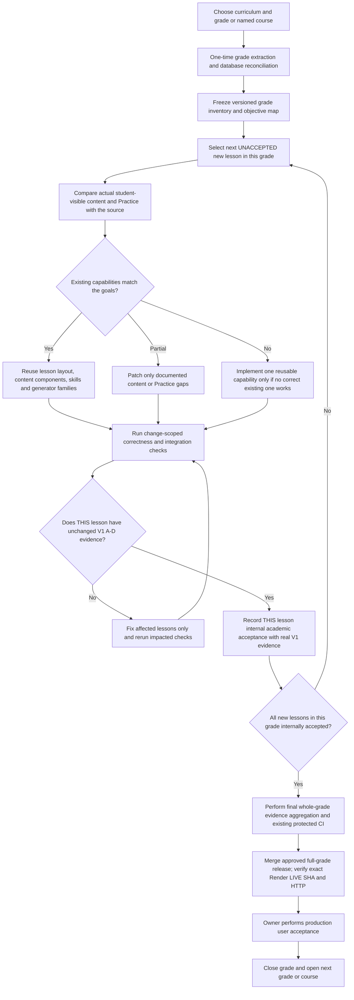

# Edulytics — Grade-First, Full-Grade Curriculum Delivery Plan (Exact Five-Lesson V1 Quality Parity)

**Plan ID:** `EDULYTICS-GRADE-FIRST-FULL-GRADE-V2`
**Status:** **Owner-approved recovery execution policy; becomes repository-active only when this branch is reviewed and merged under existing GitHub protections. No grade release is authorized by adoption alone.**
**Prepared:** 2026-10-19
**Controlling quality standard:** `EDULYTICS-GRADE-FIRST-5-V1` (2026-10-16), preserved verbatim and incorporated by reference
**Owner-approved efficiency protocol (execution scheduling only):** [Continuous authoring + concentrated final CI](EDULYTICS_FULL_GRADE_CONTINUOUS_AUTHORING_FINAL_CI_PROTOCOL_V1.md). This controls working-branch topology, avoidance of intermediate PR CI, and delayed final-SHA evidence binding; the original V1 academic criteria and all mandatory release gates remain unchanged.
**Repository:** `EIAS79/Edulytics`
**Current initial programme:** `US-CCSS-MATH` (US Common Core Mathematics)
**Release unit:** exactly **ONE complete grade** (or explicitly named high-school course) for its new release decision.
**Lesson academic judgment unit:** **ONE lesson independently** under unchanged original V1 A–D; development and evidence collection run continuously grade-wide. Final-SHA acceptance records are committed at the consolidated end-of-grade verification checkpoint rather than forcing full CI after each lesson.
**Primary operating rule:** **Extract once, reuse and repair existing lesson implementations continuously on an unpublished staging branch, retain full original V1 A–D proof per lesson, freeze the completed grade code, then run existing protected full-grade CI and certify each lesson against verified final-SHA evidence. Only after 96/96 individual academic acceptances may the ONE WHOLE GRADE be released and actually owner-tested in production.**

> **Supersession:** `EDULYTICS-GRADE-FIRST-FULL-GRADE-V2` replaces the previous Full-Grade V1 as the sole active full-grade delivery policy after protected merge. Historical Full-Grade V1 text is retained in Git history and a labeled archived copy, never as executable instruction or a second approval authority. `EDULYTICS-GRADE-FIRST-5-V1` remains unchanged and is controlling ONLY for original per-lesson A–D academic quality and evidence. The existing 50 historical published lessons, 96 candidate lessons, and their real proofs must remain intact.
>
> **Exact parity contract:** The academic-quality difference from the proven Five-Lesson V1 remains **NONE**. The permitted **operational** differences are (i) delivery/release aggregation: five lessons → one whole grade, and (ii) evaluation scheduling: cheap scoped checks while authoring on an unpublished branch; required full protected CI and exact-SHA evidence binding at the grade's final content freeze. The academic source criteria, A–D lesson work, Practice requirements, per-lesson test-based acceptance, evidence reuse, security, protected GitHub CI, Render verification and owner production UAT remain exactly as in V1. No additional accreditation, licensing ban, sign-off, new generator framework, approval platform, mandatory report ceremony or extra release gate is introduced by this plan. A full-grade aggregate simply checks that the original V1 lesson acceptances cover every new lesson. Existing mandatory CI/branch protection stays in force.
>
> **الملخص:** نعمل صفًا بعد صف؛ نستخرج فهرس الصف مرة واحدة، ثم نراجع ونصحح ونختبر **كل درس بنفس خطوات خطة الخمس دروس V1** ونسجّل اعتماده فور اكتمال أدلته. نكمل الدرس التالي دون دفعات خمسية أو إعادة مراجعة غير مبررة، ثم ننشر **الصف كاملًا مرة واحدة** بعد اكتمال اعتماد دروسه واجتياز فحوص GitHub وRender القائمة. المالك يختبر الإصدار المنشور بنفسه.
>
> This plan changes **no product code, CI, Render, database, authentication or student data merely by being adopted**; it is a specification, not a claim that release tooling or lesson approval has already passed.

---

## 1. Decision, priority, and supersession

1. The **grade/course** is the unit of curriculum planning, completion and release. Work starts with Grade 1, moves to Grade 2, etc., within the selected curriculum; high-school *named courses* follow their actual curriculum structure instead of invented grade labels. Do **not** mix courses, curricula, or grades in the full-grade release.
2. The **delivery unit** is the entire reconciled grade's canonical `LessonCode` records in stable source order. **Lesson A–D and internal acceptance remain per-lesson**, not one giant delayed review. There is no five-lesson chunk, fixed time quota or partial grade publication; **never pad with lessons from the next grade**.
3. Extract each grade's source index and reconcile its database records **once**, then cache/version the extraction for reuse. Re-extract only when the source, edition, curriculum inventory, or relevant records actually change.
4. Existing content and UI are the **default starting point**. First inspect and reuse. Change teaching content only to repair a documented mismatch; create a new mathematical generator or interactive component only when no correct reusable capability covers the objective.
5. Test **changed behavior**, not the whole platform automatically after each lesson. Required repository-wide CI/branch protection still applies until a separately verified workflow change is shipped. Never bypass red checks or re-label missing evidence as a pass.
6. **Current Grade 1 baseline, as audited on 2026-10-19:** 146 canonical lessons; ordinals **1–50** have historical prior-batch merges/releases ending with [PR #566](https://github.com/EIAS79/Edulytics/pull/566) and main SHA `2c7c43a8f3af7151d422acc6e8e9e8fa5348833c`. Preserve all 10 existing five-lesson releases and their evidence; do **not** rewrite, reauthor or recertify those individual lessons by assertion. New academic acceptance scope is **51–146 (96 lessons)**; the first unaccepted ordinal is **51**. The candidate PR [#567](https://github.com/EIAS79/Edulytics/pull/567) is unmerged/draft, containing implementations but no newly recorded internal acceptance in the examined 2026-10-19 snapshot. **Reuse that work; do not restart the code from 51, reimplement the grade or turn source screening into approval.** Reconcile changed live state before execution.
7. The developer may checkpoint and commit coherent lesson-specific or shared-capability changes without waiting for five, but **no incomplete new grade learner-content release is merged/published**. Each lesson is internally accepted promptly after the same V1 evidence, while **ONE final whole-grade release** follows the last real acceptance and all existing mandatory checks. Finish Grade 1 before starting Grade 2 as the normal sequence.

### Which previous instructions this replaces

| Historical document / rule | Status under this plan |
|---|---|
| `docs/curriculum/US_CCSS_GRADE_BY_GRADE_LESSON_ACADEMIC_CERTIFICATION_PLAN.md`, formerly compulsory `500 + 500 + 500 + 60` | **Superseded for future scheduling, gate scope, and release granularity.** The former document location now points here. Historical content is available through Git history; do not run 500-lesson blocks as the new default. |
| T001 first-ten manifest and `docs/curriculum/T001_AUTOMATED_LESSON_ACCEPTANCE.md` | **Historical T001-specific policy/evidence** for the ten already implemented and shipped. Do not silently apply its fixed ten-lesson SHA/check names to the full-grade release. |
| `artifacts/academic-us-ccss/04-lesson-certification-records.json` and existing six-gate records | Preserve historical evidence and statuses. Do not mass-edit, delete, manufacture PASS evidence, or translate its older decision names into new approvals without migration. |
| Uploaded ~1,500-lesson curriculum roadmap / integrated math master plan (not present under those filenames on `main` at plan creation) | Not authoritative for the **new grade-level release ordering**. Reuse valid Track A/Track B architecture and mathematical correctness requirements; do not erase useful engine specifications. |
| Source registries, standards maps, security tests, mathematics engine architecture, licences, existing school adoption rules | **Retained**; execution-schedule changes do not waive correctness, privacy, licensing, or production safety. |

**Rule of precedence:** For the **quality of each lesson**, unchanged Five-Lesson V1 §4–§5 A–D, source requirements, Practice/test evidence and the actual prior successful releases govern. This document overrides **only** the five-lesson delivery count and release aggregation with one full grade. For historical T001/G1-001–G1-010 releases, use their actual commits and evidence; for security/deployment obey current executable protections until intentionally updated. Any inconsistent README, AGENTS.md, SOP, old stale manifest cursor or historical V2/500/20 scheduling is NOT authority to restart/retest accepted 1–50, introduce new conditions or resume five-lesson publication.

---

## 2. Programme and grade order

**Initial programme:** US Common Core Mathematics (`US-CCSS-MATH`). The currently documented inventory covers **1,560 unique lessons**, Grades 1–8 plus explicitly named high-school courses and supplements; **Kindergarten is not in that recorded scope**. This inventory is **not** a count of approved lessons.

| Order | Grade/course in existing inventory | Recorded lesson count | Full-grade releases |
|---:|---|---:|---:|
| 1 | Grade 1 | 146 | 1 |
| 2 | Grade 2 | 146 | 1 |
| 3 | Grade 3 | 143 | 1 |
| 4 | Grade 4 | 149 | 1 |
| 5 | Grade 5 | 148 | 1 |
| 6 | Grade 6 | 147 | 1 |
| 7 | Grade 7 | 145 | 1 |
| 8 | Grade 8 | 131 | 1 |
| Then | Algebra 1 | 132 | 1 |
| Then | Geometry | 124 | 1 |
| Then | Algebra 2 | 120 | 1 |
| Then | Named advanced supplements/courses | 29 in total across several separate courses | One release per independently named course |

**Counts are a snapshot**, taken from `docs/curriculum/us-ccss-g1-g12-structural-audit.json` (snapshot dated 2026-10-11). Reconcile with the current database and official source before freezing each grade manifest; do not blindly assume a grade/course is complete or academically approved because its index exists. Each high-school course is its own release unit; never pool unrelated supplements into one invented grade.

**Grade 1 baseline (audit checkpoint 2026-10-19, reverify before implementation):** **146** canonical lessons; **50 historical already merged/released** through original Five-Lesson V1 batches G1-001–G1-010; **96 new, ordinals 51–146**. Grade 1 has **one outstanding whole-grade release**, composed of historical 50 references plus 96 independently accepted new lessons. The new acceptance cursor begins at **51**; the pre-existing unmerged implementation covers **51–146 as candidates** (its separate records do not establish any lesson acceptance). Preserve each original lesson's unit and source identifier. **A candidate implementation is not an approval; do not reauthor it unless Stage A proves a defect.**

**Later programmes:** The British/England, UAE, and Polish curriculum packs already represented in Edulytics are **not automatically included** in this US-CCSS execution count. Apply the same grade-first mechanism separately when explicitly selected, respecting each curriculum's own grade/year/stage naming and edition, rather than mapping foreign levels to US Grade 1 by guesswork.

---

## 3. Execution map



### Two independent technical tracks

- **Track A — Curriculum/lesson intelligence:** which publisher objective, standards outcome, grade, prerequisite, worked examples, representations, teaching content and **allowed/forbidden Practice families** belong to this exact lesson?
- **Track B — Mathematics intelligence:** can our existing generator, solver, verifier, normalizer, feedback and adaptive question selector support that skill safely?
- The **SkillContract** binds A to B. The lesson's student-visible body and the real Practice behaviour are both checked against this contract, so changing prose cannot silently leave unrelated questions attached to it.
- Reuse the existing Rich Lesson Content / Rich V2 composer, Practice V1 and Adaptive V2, first-party visual components, and database-backed scoring. **No custom Razor/React or JavaScript UI rebuild for a normal text/content-only lesson.**

---

## 4. One-time grade intake (not repeated per lesson)

**Input:** curriculum ID, actual grade/course label, edition/version, official publisher preparation/lesson sources already authorized, standards mapping, canonical Edulytics content, and actual database inventories. For US Grade 1 T001, the documented original preparation pages use **Illustrative Mathematics / Kendall Hunt IM K–5 2021**, aligned to US CCSS. Verify the source edition for each subsequent grade; do not assume every grade or foreign programme uses this edition.

**Procedure:**

1. Enumerate all canonical `LessonCode` records ordered by official grade/course, unit and lesson sequence; check missing IDs, duplicates, optional lessons and discrepancies between database, content bundles and publisher index.
2. Capture each lesson's title, exact source URL, source edition, content hash (when available), CCSS/official outcomes, objectives, representations/activities, and licence/attribution flags. Keep publisher HTML and third-party images out of Git unless the licence and authorization allow them.
3. Read the **existing actual learner-visible material**, after canonical JSON materialization / runtime patches—not merely template file titles. Locate explanation, goals, examples, common mistakes, images, summary, Practice contracts, generator families and feedback.
4. Match objectives to existing canonical skills and shared capabilities; create a **gap inventory**. Classify each lesson `READY_REUSE`, `CONTENT_REPAIR`, `PRACTICE_REPAIR`, `NEW_SHARED_CAPABILITY`, or `BLOCKED_SOURCE`.
5. Freeze a grade-specific, reproducible manifest containing ordered lesson IDs, source/edition identity, relevant content/version hashes, change classification, known prerequisites, current approval and production states, and last-verified date. **This is the grade's reusable input.**
6. Keep a **single reusable grade inventory** and a small checkpoint of per-lesson V1 A–D evidence/acceptance and the **next unaccepted ordinal**; never produce five-lesson slices or repeat grade extraction each session. The existing historical crosswalks and source cache are evidence to reuse, not a new reason to rebuild content.

**Re-intake trigger:** source edition changed, grade inventory changed, hashes changed, mapping drift detected, or authorization/licensing changed. If only one lesson changed, update its record; don't repeat all source reading unless necessary.

**Existing repository conventions (illustrative; use actual paths, never move/duplicate to satisfy this plan):**

```text
docs/curriculum/
  EDULYTICS_GRADE_FIRST_FULL_GRADE_EXECUTION_PLAN_V2.md  # proposed release-boundary policy (no relocation required)
artifacts/curriculum-delivery/
  US-CCSS-MATH/
    G1/
      grade-manifest.json             # existing stable inventory + source hashes; reuse, DO NOT duplicate
      full-grade-progress.json         # existing candidate checkpoint if verified
      batches/                       # preserve all already published G1-001...G1-010 artifacts untouched
        ...                            # original source/lesson approvals only
      full-grade-academic-evidence-matrix.json # optional existing index; not a new gate
```

Keep detailed logs, screenshots, generated student responses and browser traces as **CI artifacts** or private temporary evidence rather than placing unnecessary student/publisher data in the repository.

---

## 5. The original V1 lesson cycle A–D, then ONE full-grade release E–F

### Stage A — Select and compare (the next unaccepted lesson)

- Load the **next unaccepted new lesson** by stable grade ordinal and original source unit association; do not jump ahead just to maximize authored code. A genuinely blocked lesson stays explicitly `BLOCKED` and is escalated for its actual source/capability fix; it cannot be counted accepted or silently skipped.
- Compare each lesson's actual learning outcomes against the effective teaching body and the current Practice contract, examples, explanations and expected student response.
- Group defects by type; one shared issue (e.g., wrong graph-family mapping) is fixed once for all affected lessons.
- Do not rewrite content that already teaches the correct objective, even if another stylistic version could be generated. **Inspect the existing #567 candidate before editing; choose `READY_REUSE` wherever its actual effective lesson already qualifies.**

### Stage B — Prepare accurate teaching content

- **Reuse first:** existing explanation, worked examples, step-by-step methods, diagrams, misconception corrections, summary, age-appropriate language and the Rich V2 layout.
- **Modify only when needed:** incorrect mathematics, omitted learning objective, confusing age level, unsupported representation, mismatch between explanation and exercised skill, faulty worked step, missing accessibility description, licence/attribution issue.
- Use **structured lesson data** (goal, introduction/activity, concepts, examples, worked steps, answer checks, mistakes/corrections, summary, learning-task metadata) in the shared renderer. No per-lesson UI coding for text changes.
- If original material must be paraphrased or first-party authored, preserve the **instructional goal** rather than blindly copying publisher prose, artwork or trademarks.
- The teacher's narrative goal and what a self-paced digital activity can automatically prove are different: retain real-world tasks pedagogically, but don't claim a synthetic test performed a real classroom survey.

### Stage C — Connect precise Practice

- Assign the existing canonical `SkillContract`, approved family/families, difficulty range, parameter/domain bounds, answer representation and verifier, including prohibited unrelated fallback families.
- Verify that questions measure the **same work the learner was taught**, not merely the same broad topic. If the lesson asks a child to **construct** an expression, sort a set of objects, or build a graph, do not silently replace the target with a generic multiple-choice question.
- Prefer **existing math capability**. Only extend Track B when an important skill cannot be represented, generated or graded correctly; implement the capability generically where possible so later lessons share it.
- Verify independently that generated correct answers match the lesson, and a plausible wrong response is rejected. Confirm parameter variation does not exceed grade and skill constraints.
- Preserve student ownership, actual server grading and persisted attempts. Do not alter student grades, school adoptions, tenant membership, historic assessments or official outcomes as a side effect of lesson authoring.

### Stage D — Verify the change, not the entire programme (unchanged V1)

Minimum *targeted* acceptance for each modified lesson:

1. **Identity and source:** title, grade, `LessonCode`, unit, outcome mapping, edition/provenance, licence flag and absence of unrelated content.
2. **Visible content:** the actual composed student lesson contains the goal, appropriately correct steps/examples/representations and a valid summary; required assets resolve.
3. **Practice fidelity:** the lesson chooses only allowed families; generation produces diverse valid items; an independent verifier accepts correct answers and rejects wrong/malformed ones.
4. **Integration only as affected:** confirm the changed component is reachable via the real Practice path and student work/grades persist. A newly authored interaction gets targeted desktop/mobile, keyboard, submission and accessibility checks.
5. **Safety:** a change to authentication/ownership/school isolation must receive scoped negative authorization tests; otherwise do not rerun every tenant test for text-only changes.
6. **No counterfeit success:** missing source/licensing evidence, a failing scoped test, or an unimplemented capability leaves the affected lesson `BLOCKED`/`FAILED` and unapproved.

**Verification selection matrix**

| Change type | Targeted checks on every affected lesson | Larger checks? |
|---|---|---|
| Correct text/example/summary or metadata only | Content schema/render checks; reference math for changed examples; source/goal match | No full-project regression solely for a text edit |
| Existing skill/Practice family re-mapped | Contract/family selection, parameter boundaries, independent grading, reject wrong answers, persistence path if mapping changed | No global sweep by default |
| New generator, solver or answer format | Dedicated mathematical property/edge/negative tests and integration; ensure shared-family consumers are not broken | Add impacted shared-engine consumer tests |
| New/altered interactive UI | Component tests; focus/keyboard and responsive rendering; targeted Chromium flow and saved-score test | No all-lessons browser crawl |
| Shared core engine, auth, grading persistence, schema/migration, multi-tenant boundary | Integration plus relevant broad regression/security/migration tests | **Yes**: risk-based wider CI, not optional bypass |
| Deployment configuration or release pipeline changed | Validate workflow/branch protection, deploy trigger, readiness, rollback path | **Yes**: deployment checks before changing production rules |

**Important current-state constraint:** Existing GitHub workflows, required status checks and Render's `checksPass` deploy trigger **already exist**. This plan does **not** disable them today. Simplifying CI requires an explicit follow-on engineering change to path-sensitive checks, branch protection, build dependencies and deploy gating, plus validation that documentation-only commits do not break production delivery. Until then, the present mandatory checks run normally.

### Stage E — Record EACH lesson acceptance immediately; aggregate ONE whole grade

- **On completing Stage D for lesson N, record the original V1 `LESSON_INTERNAL_ACADEMIC_ACCEPTED` equivalent for N immediately**, with its `sourceVersion/contentVersion`, mapped skills, changed files, real source/Practice/test evidence and relevant Git SHA. A mere candidate family or compiled code is never an approval. The first unaccepted ordinal is the next academic task.
- One failed lesson is **not silently counted as approved**; fix that lesson and rerun its impacted checks. Keep all other independently valid per-lesson records. Do not create a 5/5, 10/10, 20/20 or 500/500 intermediary *release* decision. **Do not re-review the original already accepted 1–50 as new lessons**.
- The internal Edulytics decision stays **per-lesson test-based acceptance using unchanged Five-Lesson V1 §5 A–D**, aggregated into a single full-grade report: for current Grade 1, **50 historic release references + 96/96 genuinely accepted new lessons**. No external academic specialist signature, observed child work, teacher classroom signature, pixel-by-pixel publisher figure proof or pre-deployment owner production UAT is newly required. No blanket approval based on code compilation.
- Final grade eligibility is `GRADE_READY` **only when every new lesson passes** and the 146-lesson inventory reconciles to 50 preserved historic references plus 96 new true internal acceptances. `BLOCKED`, `FAILED`, missing evidence or a red still-required CI check means **NO_GO**; an intentionally passing negative-control test does not prove eligibility.
- **Git commits are checkpoints, not approval/release boundaries.** Save coherent changes and real proofs at sensible points, preferably one focused workstream; **do not produce repeated commits solely to refresh a SHA or synthetic paperwork**, and do not rewrite or discard the existing candidate history. No mandatory 10–25 minute manual certification-report ritual. When the grade is genuinely ready, prepare the final one-grade PR/merge under current GitHub protections.

### Stage F — Deploy and owner acceptance

- Publishing is **ONE complete grade/course at a time**, subject to the SAME protected GitHub `main` merge rules and Render `checksPass` policy as original V1. A Git commit, positive unit test, negative-control success, or green build is not proof that production is live.
- Verify deployment ID, exact commit SHA, `live` state, basic HTTP health, and grade/lesson inventory. If deployment fails, do not announce it as published; preserve previous live release, diagnose, and retry only after evidence warrants it.
- The product owner tests functionality **personally in production after the single verified whole-grade deployment** (and after subsequent independently approved corrective releases). Provide direct lesson URLs or the authenticated navigation path and the same short V1 manual UAT checklist: read content, generate Practice, deliberately submit right/wrong responses, inspect grade/saved attempt, view on phone when the UI changed.
- Report owner-found bugs as a scoped fix; redo only affected validation unless the fix touches shared functionality.
- If a schema/data migration is involved, follow the same V1 production backup and migration runbooks. Do not create a fresh database branch for every text-only lesson; avoid unnecessary production data mutations.

---

## 6. Suggested data contracts (for future implementation)

The following is an illustrative shape, **not** a claim that these fields are already in the production data model:

```json
{
  "planId": "EDULYTICS-GRADE-FIRST-FULL-GRADE-V2",
  "curriculumId": "US-CCSS-MATH",
  "gradeOrCourse": "Grade 1",
  "edition": "IM-K5-2021",
  "gradeInventoryVersion": "<verified source/DB snapshot hash>",
  "gradeReleaseId": "US-CCSS-G1-FULL-GRADE",
  "historicPreservedOrdinals": "1-50 (original evidence references only)",
  "newAcceptanceOrdinals": "51-146 (all 96 new lessons, individually evidenced)",
  "lessonCodes": ["<all 146 verified canonical LessonCodes in original order>"],
  "classification": "<per-lesson READY_REUSE or repair category>",
  "status": "PLANNED",
  "targetCommitSha": null,
  "acceptance": {
    "approvedCount": 0,
    "blockedCount": 0,
    "originalLessonQualityPolicy": "EDULYTICS-GRADE-FIRST-5-V1",
    "deliveryPolicy": "EDULYTICS-GRADE-FIRST-FULL-GRADE-V2",
    "tests": [],
    "evidenceReferences": []
  },
  "deployment": {
    "renderService": "Edulytics",
    "renderDeployId": null,
    "liveCommitSha": null,
    "ownerUat": "NOT_STARTED"
  }
}
```

Never commit tokens, database passwords, identifying student responses, unlicensed publisher assets, or invented PASS timestamps. Use proper schema and typed records when building the real tool; JSON above defines intended semantics only.

### Lesson and full-grade states (same V1 internal-acceptance meaning)

```text
GRADE_INVENTORIED (reused manifest; G1 historical 1-50 preserved)
    -> NEXT_UNACCEPTED_LESSON_SELECTED
    -> LESSON_REUSE_READY / LESSON_REPAIR_REQUIRED / LESSON_CAPABILITY_REQUIRED
    -> LESSON_TESTED / LESSON_BLOCKED
    -> LESSON_INTERNAL_ACADEMIC_ACCEPTED (immediately, for each genuinely passing new lesson)
    -> NEXT_UNACCEPTED_LESSON_SELECTED (repeat until all remaining are truly accepted)
    -> GRADE_READY (all new lessons accepted + historical release refs retained)
    -> PROTECTED_CI -> MERGED -> DEPLOYING -> LIVE -> OWNER_UAT
    -> GRADE_COMPLETE (only after inventory and actual production outcome reconciled)
```

These names describe the same V1 decisions; **do not implement a parallel status engine or migrate old historical records merely to mirror this illustration**.

When a lesson is blocked, capture `LessonCode`, missing evidence or failing test, severity, owner/fix, and stable checkpoint. Resume the same grade; don't skip the lesson and imply the grade is complete.

---

## 7. Efficiency model and realistic timing

**Targets, not a historical measured throughput or guarantee.** Fast AI text extraction is not 30 minutes of human reading. Scale comes from one-time indexing, deterministic comparisons, reusable components and running small tests concurrently.

| Work item | Engineering approach | Initial target if all dependencies already exist |
|---|---|---|
| Grade intake | One extraction + database/source reconciliation for the entire grade | Measure empirically per grade; **not repeated per lesson** |
| Single `READY_REUSE` lesson | Match source, preserve/adjust text and map existing family | **5–15 minutes** preparation and focused verification |
| Next individual lesson | Run unchanged V1 A–D, persist evidence and acceptance before progressing | Variable; reuse existing candidates and measure actual durations, not arbitrary quotas |
| Targeted checks per changed lesson | Run changed content/family tests and affected shared consumers; preserve mandatory repo CI | Variable; actual measurements only |
| New complex skill, solver, UI, source/licence gap or flaky environment | Separate reusable engineering task | **Variable; not capped by the fast-path target** |
| Merge-to-production | Current CI + queue + Render build/cold start | **Variable; track separately from lesson authoring**, never promise a fixed SLA |

**Measure rather than guess:** capture automated wall-clock durations per stage, *productive engineering edits* vs CI waiting, reused vs newly authored capability, test reruns, bugs escaped to owner UAT, % auto-aligned, and throughput per grade. Adjust targets from verified per-lesson throughput during this one grade; **never reintroduce artificial five-lesson checkpoints**. Parallel CI durations are not summed as though they were sequential developer work.

---

## 8. Non-negotiable correctness and change boundaries

- Do not fabricate academic accreditation by government, CCSS, IM/Kendall Hunt, schools or an external specialist. `INTERNAL` means Edulytics' own test-defined acceptance.
- Do not represent synthetic survey votes or test fixtures as proof that actual pupils learned or that human participants responded.
- Do not treat successful compilation as proof of aligned teaching content or correct grading.
- Do not skip unresolved source/licensing issues. Preserve existing publisher attribution and first-party asset constraints.
- Do not change curriculum IDs, official outcomes, school-adoption mappings, student grades, teacher assessments or other grades unless the change itself is explicitly scoped and verified.
- Do not force-delete old evidence, flatten historical SHA ledgers into invented full-grade PASS records, or retroactively rewrite already-shipped results. Preserve the 50 already released lessons and all verified earlier Five-Lesson V1 evidence unchanged.
- Do not modify required CI, branch-protection rules, deployment triggers, Neon state or Render services as a side effect of merely adopting this markdown plan.
- No false background-work promises. An agent can resume from a saved checkpoint when invoked, or use an explicitly configured automation; ordinary chat alone is not a persistent job runner.

---

## 9. Implementation roadmap — REUSE the successful V1 implementation, no new programme

| Phase | Deliverable | Exit criterion |
|---|---|---|
| **P0 — Authoritative policy / instruction sync** | Adopt THIS single delivery-size amendment; leave the original Five-Lesson V1 file intact as the academic-quality source; update `AGENTS.md`, README and executor SOP to point to the same policy after approval, **without relocating historical files merely for style** | No five-lesson/full-grade instruction conflict; 50 historical lessons and all old evidence untouched |
| **P1 — Reuse existing grade manifest** | Check current 146-lesson G1 index against existing source/DB snapshots and original crosswalks; do not create a new extractor if the current one works | 146 exact ordered lesson IDs; historic 50 and new 96 delineated |
| **P2 — Rescue existing candidate** | Safeguard [PR #567](https://github.com/EIAS79/Edulytics/pull/567) and its head; reuse existing authoring/Practice/visual work; fix proven build blockers; compare next unaccepted ordinal 51 against actual source and rendered code | Real, scoped defect/READY_REUSE classification, no mass rewriting or fake approval |
| **P3 — Continuous original V1 A–D authoring** | Review/repair all remaining original-source activities on an isolated un-PR'd working branch; reuse prior artifacts; do lightweight checks after a shared component change; preserve per-lesson review checkpoints; defer expensive CI and per-lesson final SHA sign-off until content freeze | 96 source/teaching/Practice candidates independently reviewed and ready for final verification, with outstanding blockers explicit |
| **P4 — No unnecessary infrastructure** | Reuse V1 grade evidence/acceptance instruments, protected CI and Render wiring; assess whether **a simple aggregate of 96 lesson decisions** is already obtainable; add no fresh approval system, CI job, schema, branch workflow or report unless a concrete unfilled need is proven | No extra release standards, no duplicated ledger authorities, no weakening required checks |
| **P5 — ONE production release** | Aggregate 50 historical links + 96 new real acceptances; pass all existing mandatory exact-commit checks; merge approved grade, verify Render actual commit LIVE, health, authenticated grading; owner production UAT | No false go-live, one complete grade release and verified production status |
| **P6 — Grade closure** | Grade manifest reconciled with each original/historical lesson and all newly reviewed Grade 1 lessons | 146 identities = 50 historical release records + 96 accepted new; no silent skips |
| **P7 — Repeat** | Grade 2 then Grade 3, etc., later separate named high-school courses | Same V1 methods, one full-grade release each, without duplicate intake/engine reimplementation |

**Rollout order:** This document is owner-approved but is not repository-active until committed and merged through protected checks. Its acceptance does not authorize merging PR #567 or deploying a red candidate. There is **no prerequisite P1–P4 infrastructure rewrite**: reuse what is already functioning under Five-Lesson V1, then process lesson 51 acceptance and continue. Specific existing CI/build failures must be fixed without bypass; protect uncommitted/local work and all historical branches before any code surgery.

---

## 10. Owner-facing report — consolidated milestone updates and one grade-release report

Do **not** interrupt continuous authoring to send a user-facing report after each lesson or commit. Keep original per-lesson evidence internally, and report to the owner only at meaningful whole-grade milestones or actual blockers; make the final grade-release report comprehensive. Example format:

```text
Curriculum / grade: US-CCSS Mathematics / Grade 1
Grade release: US-CCSS-G1-FULL-GRADE  | canonical grade inventory: 146
Historically released, evidence preserved: 1–50 (50)
New academic scope: 51–146 (96)
Current lesson / ordinal: <actual LessonCode / N>
Classification: READY_REUSE / CONTENT_REPAIR / PRACTICE_REPAIR / NEW_SHARED_CAPABILITY / BLOCKED_SOURCE
Lesson A–D and internal acceptance: <real status and exact evidence>
New lessons internally accepted: <actual>/96; new lessons pending/blocked: <actual>
Reused: <actual> | content repairs: <actual> | new shared components: <actual>
Targeted checks: <actual pass/fail with links>; still-required GitHub checks: <actual>
Commit/PR: <actual SHA/URL> | final grade release: NO_GO / eligible when real 96/96
Production deploy: NOT YET / <actual Render ID/status>; owner UAT: PENDING / PASS / ISSUES_FOUND
Blockers: <specific LessonCode and reason, or NONE>
Next: <next unaccepted new ordinal; NEVER a 5-lesson batch>
```

When the grade is actually ready and deployed, provide the final same-format whole-grade report and direct owner UAT links. A work-in-progress lesson checkpoint must never be described as production publication.

Do not fill any field with guessed values or present `READY_REUSE`, code compile success, merge success, internal academic approval, and production `LIVE` as interchangeable events.

---

## 11. Acceptance criteria for this PLAN document

This plan is the **owner-approved full-grade delivery amendment to the original successful Five-Lesson V1**, not a new acceptance model. It becomes operative only when the owner approves it and an accurate policy/instruction change is committed without bypassing required checks. This policy adoption **does not** approve a candidate lesson, turn PR #567 green, alter student data, authorize CI simplification, or deploy anything. The next software task is to **preserve existing PR #567**, correct demonstrated CI blockers with scoped tests, and resume original A–D **per-lesson acceptance at Grade 1 ordinal 51**, reusing existing 51–146 candidate implementations as appropriate. Grade release remains **NO_GO until all 96 new lessons satisfy original V1 requirements**.

**Governing principle:** *Exact original Five-Lesson V1 per-lesson academic quality, source fidelity, Practice, evidence, test and production safety; only the five-lesson PUBLISHING BOUNDARY changes to one whole grade. Preserve accepted history; inspect/reuse before repairing; accept each lesson as it qualifies; release once and verify LIVE.*

### Non-negotiable parity audit (interpretation only; NO new criterion)

| Original Five-Lesson V1 requirement | Exact Full-Grade treatment |
|---|---|
| V1 §1–§2: grade-first, stable source order and one-time intake | SAME original grade/lesson identifiers and source/version validation; no re-intake without a V1 trigger |
| V1 §3: Track A + Track B + existing SkillContract | SAME components; no parallel math engine, lesson system or UI framework |
| V1 §4 and §5 A: true source/student task vs effective actual teaching/Practice | SAME exact activity and goal comparison; `READY_REUSE` beats needless rewriting |
| V1 §5 B: correct examples, representations and Rich V2 | SAME educational quality, no invented polish/rebuild scope |
| V1 §5 C: only source-matching allowed Practice families, correct/wrong verification, stored scoring | SAME source-specific family coverage; no one-family quota or synthetic classroom proof |
| V1 §5 D: touched-behaviour tests, affected shared consumers and existing mandatory repository CI | SAME risk-based tests; never bypass existing protections |
| V1 §5 E: independent real internal acceptance per lesson | SAME meaning, recorded promptly **one lesson at a time**, aggregated as 96 new plus 50 historical references |
| V1 §5 E/F: former 5-lesson batch ready / published | **ONLY CHANGED ITEM:** one whole-grade ready / published after every new lesson accepted |
| V1 §5 F: protected merge, Render exact LIVE, HTTP, owner production UAT | SAME actual checks, after the single full-grade release; no fake pre-deploy owner acceptance |
| V1 §6–§11: privacy, licensing, checkpoints, historical records, no false PASS | SAME controls and safeguards; no forced new tools, duplicated approvals or retroactive recertification |

**Source of parity:** the original file `EDULYTICS_GRADE_FIRST_FIVE_LESSON_EXECUTION_PLAN_V1.md` remains unchanged and is controlling for any ambiguity about A–D mathematics and evidence. Grade 1's historical first 50 remain immutable, while the new release requires 96 truthful original-V1 internal decisions. This matrix is explanatory only and does not create any extra compliance test.